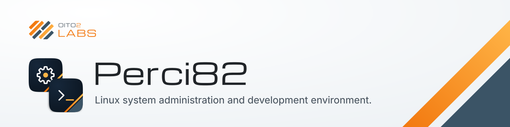
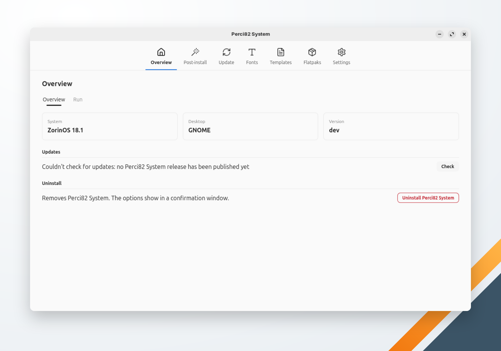

<picture>
  <source media="(prefers-color-scheme: dark)" srcset=".github/header-escuro.svg">
  
</picture>

# Perci82

Two Linux desktop apps: **Perci82 System** manages the OS, **Perci82 Dev** sets up your development environment.

   [](https://github.com/oito2/perci82/actions/workflows/ci.yml)

🌐 **Language:** English · [Português](docs/pt-br/leiame.md)

> **Status:** Perci82 System and Perci82 Dev are released (tags `system-vX.Y.Z` and `dev-vX.Y.Z`).

## Table of Contents

- [Overview](#overview)
- [Prerequisites & Quick Installation](#prerequisites--quick-installation)
- [Automated Installation](#automated-installation)
- [Update & Maintenance](#update--maintenance)
- [Documentation](#documentation)
- [License](#license)

## Overview

Perci82 is a monorepo with two independent desktop apps built with Go and [Wails v3](https://v3.wails.io). Both read and write the same `~/.perci` folder, and each is released, updated and uninstalled on its own.

| App | Binary | What it does |
|---|---|---|
| **Perci82 System** | `perci82-system` | Linux administration: post-install setup, system and app updates (packages, Snap, Flatpak), fonts, file templates and Flatpak apps |
| **Perci82 Dev** | `perci82-dev` | Development environment: prerequisites, languages and SDKs, AI apps, terminals, IDEs, Docker containers, Git repositories and accounts, AI contexts, skills and MCP servers; optional system tray |

Perci82 System's main features:

- **Post-install** — the recommended setup of Ubuntu, Ubuntu Budgie, Linux Mint, Zorin OS, Fedora and Pop!_OS, item by item.
- **Update OS & Apps** — distribution packages, Snap and Flatpak updated in one run, with a single password prompt.
- **Fonts, file templates and Flatpaks** — checklists that install what you check and remove what you uncheck.
- **Update notice and uninstall** on the Overview screen, with the `apt`/`dnf` command to copy; Portuguese and English interface; oito2 themes.

Perci82 Dev's main features:

- **Environment** — prerequisites, languages and SDKs, AI apps, terminals, IDEs, Android Studio and Antigravity IDE, installed, updated and removed item by item.
- **Docker** — an Nginx and MariaDB stack with HTTPS at `https://<app>.localhost`, Moodle, PHP, Node and PHP + Node app containers, each with its own command in `~/.local/bin`, development folders mounted into the apps, and a Behat test site per Moodle app with an optional shared Selenium for `@javascript` scenarios.
- **Repositories** — Git accounts with their own SSH key, identity and API token; each account's repositories, with clone, pull and export/import.
- **AI Contexts** — rules for Claude Code, Gemini, Codex, OpenCode and Antigravity in each project, from Perci82's standards and your own custom contexts, with project notes kept outside the repository.
- **Skills & MCPs** — skills from skills.sh and MCP servers, Build82 and Sync82 included, registered with the coding agents.
- **System tray** with a compact Containers window; update notice and uninstall on the Overview screen; Portuguese and English interface; oito2 themes.



## Prerequisites & Quick Installation

| OS | Status | Distributions | Runtime dependencies |
|---|---|---|---|
| Linux (amd64) | Supported | Debian 13+, Ubuntu 24.04+, Linux Mint 22+, LMDE 7+, Zorin OS 18+, Pop!_OS 24.04+ (`apt`) or Fedora 40+ (`dnf`) | `apt`: `libgtk-4-1 libwebkitgtk-6.0-4` · `dnf`: `gtk4 webkitgtk6.0` |
| Windows | Not supported | — | — |
| macOS | Not supported | — | — |

Releases are `.deb` and `.rpm` packages for Linux amd64, published in a signed `apt`/`dnf` repository; the package manager installs the GTK 4 and WebKitGTK 6.0 runtime libraries they depend on. To install, see [Automated Installation](#automated-installation); adding the repository by hand and installing a downloaded package are in [Installing Perci82 System](docs/en/system/installation.md#add-the-repository-by-hand) and [Installing Perci82 Dev](docs/en/dev/installation.md#add-the-repository-by-hand).

### Build from source

Requirements:

- Linux on amd64.
- Go 1.27.4 or later.
- GTK 4 and WebKitGTK 6.0 development packages, for example on Debian/Ubuntu:

  ```bash
  sudo apt install -y build-essential pkg-config libgtk-4-dev libwebkitgtk-6.0-dev
  ```

- Node.js, only to run the frontend tests.

Build and run:

```bash
git clone https://github.com/oito2/perci82.git
cd perci82
make build          # writes ./perci82-system and ./perci82-dev
./perci82-system
./perci82-dev
```

Run the checks:

```bash
make lint
make test
make test-frontend
make check-generated
make check-bindings   # needs the wails3 CLI of the Wails version in go.mod
```

The colors, measures, presets and common interface texts (OK, Cancel, Back…) come from [oito2_ui](https://github.com/oito2/oito2_ui), copied as fixtures into `internal/theme/parity/`. To update them, check out oito2_ui into `references/oito2_ui` (or pass `OITO2_UI=<dir>`) and run:

```bash
make parity-sync
make generate
```

## Automated Installation

One script installs either app or both. It asks which ones:

```bash
curl --proto '=https' --tlsv1.2 -fsSL https://raw.githubusercontent.com/oito2/perci82/main/install.sh | bash
```

Or name them — `system`, `dev` or `all`:

```bash
curl --proto '=https' --tlsv1.2 -fsSL https://raw.githubusercontent.com/oito2/perci82/main/install.sh | bash -s -- system dev
```

The script needs `curl`, `gpg` and `sudo`. It downloads the Perci82 repository key and checks its fingerprint (`A1B1 AC75 B535 0344 B6C8  043C FF9E 1B0F 3C2A 545F`), adds the package repository (`https://oito2.github.io/perci82/`) to `apt` or `dnf`, and installs the packages `perci82-system` and/or `perci82-dev`. When the old Perci (`prci`) is installed, it asks whether to remove it; its settings in `~/.perci` are kept, since both apps read them.

## Update & Maintenance

- **Update:** the package manager updates both apps with the rest of the system (`sudo apt update && sudo apt upgrade` or `sudo dnf upgrade`). Overview → **Check** looks for a newer release and, when the app runs from its package, shows the command that installs it. Builds from source report the version `dev`.
- **Uninstall:** Overview → **Uninstall** cleans up what is the app's: "Also remove the settings" removes only that app's settings (and, in Perci82 Dev, its Git account files in `~/.perci` and, with the Docker containers, its Docker stack files, keeping the MariaDB backups); `~/.perci` itself goes only when no other Perci82 app nor the old Perci is installed and nothing else is left in it. Perci82 Dev's uninstall window also offers backups of Docker, repositories and AI contexts, and removing the Docker containers. It ends by showing the command that removes the package (`sudo apt remove perci82-<app>` or `sudo dnf remove perci82-<app>`). See [Uninstalling Perci82 System](docs/en/system/uninstallation.md) and [Uninstalling Perci82 Dev](docs/en/dev/uninstallation.md).

## Documentation

- [Documentation index](docs/en/index.md)
- [Installing Perci82 System](docs/en/system/installation.md) and [uninstalling it](docs/en/system/uninstallation.md)
- Perci82 System's screens: [Overview](docs/en/system/overview.md), [Post-install](docs/en/system/post-install.md), [Update OS & Apps](docs/en/system/update.md), [Fonts](docs/en/system/fonts.md), [Templates](docs/en/system/templates.md), [Flatpaks](docs/en/system/flatpaks.md), [Settings](docs/en/system/settings.md)
- [Installing Perci82 Dev](docs/en/dev/installation.md) and [uninstalling it](docs/en/dev/uninstallation.md)
- Perci82 Dev's screens: [Overview](docs/en/dev/overview.md), [Environment](docs/en/dev/environment.md), [Docker](docs/en/dev/docker.md), [Repositories](docs/en/dev/repositories.md), [AI Contexts](docs/en/dev/ai-contexts.md), [Skills & MCPs](docs/en/dev/skills-mcps.md), [Settings](docs/en/dev/settings.md)
- Troubleshooting: [Perci82 System](docs/en/system/troubleshooting.md) and [Perci82 Dev](docs/en/dev/troubleshooting.md)
- [Contributing](CONTRIBUTING.md) — building, checks, pull requests and releases
- [Code of Conduct](CODE_OF_CONDUCT.md)

## License

GPL-3.0 — see [LICENSE](LICENSE).
