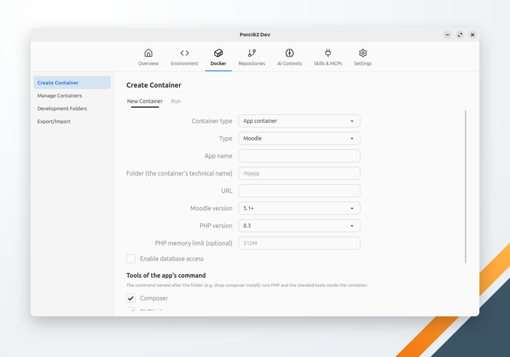

🌐 [Português](../../pt-br/dev/docker.md) | **English** | 🏠 [Index](../index.md)

---

# Docker

Creates and manages a local development stack in Docker: one Nginx reverse proxy that serves every app over HTTPS at `https://<app>.localhost`, one shared MariaDB database, one container per app and, optionally, a shared Selenium container for Moodle's Behat tests. The side list has four screens: **Create Container**, **Manage Containers**, **Development Folders** and **Export/Import**.



## The stack

Every container joins the Docker network `docker-php-network` and restarts with Docker (`--restart unless-stopped`), except Selenium, which stays stopped after the computer restarts until you start it. Nginx, MariaDB and Selenium exist once each; apps are identified by their folder name, which is also the container's name.

| Container | Image | Published on the host | What it does |
|---|---|---|---|
| Nginx | `nginx:1.26-alpine` | `127.0.0.1:80` and `127.0.0.1:443` | Routes each app's `<name>.localhost` URL to its container; any other `*.localhost` name answers 404 |
| MariaDB | `mariadb:11.4` | `127.0.0.1:3306` | Shared database server with the database `dev_db` |
| Selenium (optional) | `selenium/standalone-chrome:4.52.0-20261101` | `127.0.0.1:7900` (noVNC) | Chrome for the `@javascript` [Behat](#behat) scenarios of every Moodle app |
| App | built by Perci82 Dev (see below) | — | Runs the app's PHP (php-fpm) and/or Node dev server |

The HTTPS certificate is made with mkcert when the Nginx container is created. It covers `*.localhost`, `localhost` and each app's URL by name, and is generated again when it lacks a name or expires within 30 days. mkcert's certificate authority is also added to the browsers installed as Flatpaks (this needs `certutil`, which the Mkcert prerequisite brings); restart those browsers afterwards. Nginx's routing is rewritten and reloaded without downtime every time an app is created, edited or removed.

### App types

| Type | Image | Project root inside the container | How Nginx serves it |
|---|---|---|---|
| Moodle | `perci-php<version>` | `/var/www/html`; moodledata at `/var/www/data` | Files and PHP; the web root is `public/` for Moodle 5.1+ |
| PHP | `perci-php<version>` | `/var/www/html` | Files and PHP |
| Generic | `perci-php<version>` | `/var/www/html` | Files and PHP (set up the same way as PHP) |
| Node | `perci-node<version>` | `/app` | Proxies every request to the dev server's port (WebSockets included, for hot reload) |
| PHP + Node | `perci-php<version>-node<version>` | `api/` at `/var/www/html`, `app/` at `/app` | `/api/` goes to PHP; everything else is proxied to the dev server |

The PHP images are built on the first use of each PHP version and include Composer, PHPUnit, PHP_CodeSniffer, Xdebug, Redis and the Moodle coding standard (moodle-cs 3.7.0, with PHPCSExtra 1.5.1 and PHPCSUtils 1.2.3), plus the `en_AU.UTF-8` locale that Moodle's PHPUnit requires and the `pt_BR.UTF-8` locale. PHP runs as `www-data` with your user's UID, and Node runs as the image's `node` user with your UID, so files they write in the project stay yours. In a PHP + Node container, supervisord runs php-fpm, the dev server (in `app/`) and the optional worker (in `api/`).

With **Enable database access** on, the app container gets the variables `DB_HOST=mariadb`, `DB_PORT=3306`, `DB_USER`, `DB_PASS` (the MariaDB credentials) and `DB_NAME=dev_db`. No app configuration file is written from them.

### Where the files go

The workspace is `~/workspace` unless another folder is set in **Workspace path** in [Settings](settings.md).

| Path | Content |
|---|---|
| `<workspace>/localhost/html/<folder>` | The app's project root (PHP + Node: `api/` and `app/` inside it) |
| `<workspace>/localhost/data/<folder>` | Moodle's moodledata (Moodle only; other users have no access) |
| `<workspace>/localhost/logs/<folder>` | PHP's `error.log` (every type but Node) |
| `<workspace>/localhost/logs/nginx` | Nginx's logs |
| `<workspace>/localhost/databases/mariadb` | MariaDB's data |
| `~/.perci/appstack/nginx/default.conf` | Nginx's generated routing |
| `~/.perci/appstack/certs` | The `*.localhost` certificate |
| `~/.perci/appstack/mariadb/init` | MariaDB's init script (grants the user every privilege) |
| `~/.perci/appstack/php-conf/<folder>` | The app's PHP memory limit override |
| `~/.perci/appstack/backups` | MariaDB backups taken before an image update |
| `~/.local/bin/<folder>` | The [app's command](#the-apps-command) |
| `/etc/systemd/system/*.mount` | The mounts of [Development Folders](#development-folders) |

The container settings are saved in `~/.perci/config.yaml`.

## Create Container

Choose the **Container type**: **Nginx**, **MariaDB**, **Selenium**, **App container** (then **Type**: **Moodle**, **PHP** or **Generic**), **Node** or **PHP + Node**. Nginx, MariaDB and Selenium are disabled once they exist. Click **Create Container**; the progress shows in the run log.

Docker must be installed. The Nginx container also needs mkcert, installed in [Environment → Prerequisites](environment.md). The first Nginx creation runs `mkcert -install`, which can ask for the administrator password outside Perci82 Dev: the screen warns about it, and if it hangs, run `mkcert -install` once in a terminal before clicking **Create Container**.

**Nginx** and **Selenium** have no fields. **MariaDB** asks for **Database user** (letters, digits and `_`, 1-32 characters; `dev_user` by default) and **Password** (a random one is filled in). A root password is generated and saved. When the data folder already holds a database made with other credentials, the creation is refused: MariaDB ignores new credentials on existing data.

App fields:

| Field | Types | Notes |
|---|---|---|
| **App name** | all | Display name |
| **Folder (the container's technical name)** | all | Letters, digits, `-` and `_`, starting with a letter or digit (2-64 characters, as Docker requires for a container name); `nginx`, `mariadb` and `selenium` are reserved. Names the project folder, the container and the command |
| **URL** | all | One label followed by `.localhost`; filled from the folder until you edit it; one URL per app |
| **Moodle version** | Moodle | `3.x`, `4.1`, `4.2-4.3`, `4.4-4.5`, `5.0` or `5.1+` |
| **PHP version** | Moodle, PHP, Generic, PHP + Node | `7.4` to `8.4`; for Moodle, only the versions that Moodle version supports |
| **PHP memory limit (optional)** | Moodle, PHP, Generic, PHP + Node | Like `512M`, `1G` or `-1`; empty keeps `512M` |
| **Node version** | Node, PHP + Node | `22`, `24` or `26` |
| **Start command** | Node, PHP + Node | The dev server's command (`npm run dev` by default). In PHP + Node it isn't run through a shell: for `&&` or pipes, use `sh -c "…"` |
| **Port** | Node, PHP + Node | The dev server's port (`5173` by default), 1024-65535 except 3306 and 9000 |
| **Worker command (optional)** | PHP + Node | A background process (for example a queue consumer), run through `sh -c` in `api/` |
| **Enable database access** | Moodle, PHP, Generic, PHP + Node | Available once MariaDB exists |
| **Behat test site** | Moodle | Off by default. Serves the app's folder also at `http://<folder>-behat.test` for [Behat](#behat); the folder then needs at most 57 characters, with only letters, digits and hyphens |
| **Tools of the app's command** | every type but Node | Checklist: **Composer**, **PHPUnit**, **PHP_CodeSniffer (phpcs and phpcbf)** and, for Moodle, **moodle-cs (Moodle's coding standard in phpcs)**. All checked by default |

Moodle versions and PHP:

| Moodle version | PHP |
|---|---|
| 3.x | 7.4 |
| 4.1 | 7.4, 8.0, 8.1 |
| 4.2-4.3 | 8.0, 8.1, 8.2 |
| 4.4-4.5 | 8.1, 8.2, 8.3 |
| 5.0 | 8.2, 8.3, 8.4 |
| 5.1+ | 8.3, 8.4 |

Creating an app creates its folders, builds the image when that version is used for the first time (this can take a few minutes), starts the container, writes its command and updates Nginx's routing. Perci82 Dev doesn't install the app's code: put it in the project folder.

## Manage Containers

A table with each container (apps show as `<name> (<type>)`), its status and its actions. The status is Docker's: **running**, **restarting**, **paused**, **created**, **stopped**, **dead**, **not found** or **Docker unreachable**.

| Action | Containers | What it does |
|---|---|---|
| **Start** / **Stop** / **Restart** | all | Starts, stops or restarts the container |
| **Recreate** | all | Removes the container and creates it again with the saved parameters (and writes the app's command again) |
| **Update image** | all | Pulls or rebuilds the image at the newest fix of the same version and recreates the containers that use it; nothing is recreated when nothing changed. Selenium's image has a fixed tag, which changes only with a Perci82 Dev update |
| **Create the app's command** | apps that still have the old `php-<folder>`, `composer-<folder>`… commands | Replaces them with the [app's command](#the-apps-command), without recreating the container |
| **Behat configuration** | Moodle apps with **Behat test site** on | Shows the lines to add to the app's `config.php` and the commands that initialize the test site and run the scenarios, each with **Copy** (see [Behat](#behat)) |
| **View Logs** | all | Shows the container's last 200 lines; **Update** fetches them again and **Export** saves them to a `.txt` file |
| **Edit** | MariaDB and apps | Opens the creation fields with the current values. For an app the folder can't change; the image is built and the input checked before the running container is replaced. For MariaDB, new credentials are refused when the data was created with others |
| **Backup** | MariaDB | Saves every database to a `.sql` file you choose (MariaDB must be running) |
| **Restore** | MariaDB | Loads a `.sql` file, overwriting MariaDB's current data (MariaDB must be running) |
| **Remove** | all | Removes the container and its settings. Project, data and database folders stay on disk. For an app, its command and old commands are deleted and Nginx's routing is updated |

**Update images**, above the table, updates the images of every container the same way. Files, databases and mounted folders are kept. Before MariaDB is recreated by an update, a full backup is saved in `~/.perci/appstack/backups`; MariaDB must be running for that, or the update stops.

## The app's command

Each app gets one command named after its folder in `~/.local/bin`. It runs a tool inside the app's container:

```bash
shop composer install
mdle-401 phpcs --standard=moodle local/x
site npm test
shop -v
```

The first argument picks the tool when it is one of the type's subcommands; anything else runs through `php` (`node` in a Node app), as `shop -v` runs `php -v`.

| Type | Subcommands | Otherwise | Runs as | Project folders in the container |
|---|---|---|---|---|
| Moodle, PHP, Generic | `composer`, `phpunit`, `phpcs`, `phpcbf` | `php` | `www-data` (your UID) | `/var/www/html` |
| Node | `npm` | `node` | `node` (your UID) | `/app` |
| PHP + Node | `composer`, `phpunit`, `phpcs`, `phpcbf`, `npm` | `php` | `www-data` (your UID) | `api/` → `/var/www/html`, `app/` → `/app` |

- **Tools checklist:** a tool unchecked in **Tools of the app's command** (saved as `disabled_tools`) answers `<tool>: tool not enabled in this app (<app>) — enable it in Docker → Manage Containers → Edit` and exits with code 2. **PHP_CodeSniffer** covers `phpcs` and `phpcbf`; `npm` is always on.
- **moodle-cs:** in a Moodle app with **moodle-cs** checked, `phpcs` and `phpcbf` know the Moodle standard (`--standard=moodle`). After switching an older app to its command, moodle-cs is available once the container is recreated or its image updated.
- **Working folder:** when the current folder is inside the app's project, the command runs in the matching folder inside the container. Outside it, it runs in the project root and says `<app>: the current folder is outside the app — running in <dir>`. Arguments that are paths into the project are rewritten to the container's paths.
- **Terminal:** the command is interactive in a terminal and works in scripts and pipes too.
- **Collisions:** when another program already has the app's name (a file in `~/.local/bin` that Perci82 Dev didn't write, or a command on `PATH`), the command isn't created and the old `<tool>-<folder>` commands are written instead.
- **Lifecycle:** the command is written when the container is created, recreated or edited, and deleted with **Remove**. `~/.local/bin` is added to your shell's rc file (`~/.bashrc`, `~/.zshrc` or fish's `config.fish`) when it isn't on your `PATH`.

## Behat

Moodle's Behat tests run against a second site, `$CFG->behat_wwwroot`, that serves the same Moodle folder. With **Behat test site** on, a Moodle app gets one:

- **Address:** `http://<folder>-behat.test` (the folder in lowercase), HTTP only. Nginx serves it from the app's folder and PHP, with the same routing as the app. It doesn't block `/behat/` and `/fixtures/`, which the tests use; the app's own site still does.
- **Reachable from the containers:** the name is a network alias of the Nginx container on `docker-php-network`, so the app container (where Behat runs) and Selenium (where Chrome runs) reach it. It is not reachable from the host's browser. The name is outside `.localhost` because PHP's curl and Chrome resolve every `*.localhost` name to the loopback address without asking DNS. Turning the option on or off reconnects the Nginx container to the network with the new names, without recreating it; if that fails, the run log says so and **Recreate** on Nginx applies them.

Perci82 Dev never edits `config.php`. **Behat configuration**, in the app's row of Manage Containers, shows what to add before `require_once(__DIR__ . '/lib/setup.php');`:

```php
// Behat.
$CFG->behat_wwwroot  = 'http://mdle-behat.test';
$CFG->behat_prefix   = 'bht_';
$CFG->behat_dataroot = '/var/www/data/behat';
```

The prefix keeps the test site's tables apart from the app's, and the data folder lives in the app's moodledata (the container's only writable, persistent folder). The window also shows the commands, run through the [app's command](#the-apps-command) (in Moodle 5.1+, `admin/` is `public/admin/`):

```bash
mdle admin/tool/behat/cli/init.php
mdle vendor/bin/behat --config /var/www/data/behat/behatrun/behat/behat.yml --tags='@local_example&&~@javascript'
```

There is one run command per plugin mounted in the app in [Development Folders](#development-folders) (with a placeholder component when there is none). Run `init.php` again after Moodle upgrades, plugin installs or new step definitions.

**`@javascript` scenarios** need a browser. Create the **Selenium** container (Create Container → Selenium): one Chrome serves every Moodle app, reached at `http://selenium:4444/wd/hub`. With it, **Behat configuration** adds the profile below and the run commands no longer leave `@javascript` out:

```php
$CFG->behat_profiles = [
    'default' => [
        'browser' => 'chrome',
        'wd_host' => 'http://selenium:4444/wd/hub',
    ],
];
```

Selenium runs with a 2 GB `/dev/shm` (Chrome fails with Docker's 64 MB default) and up to two sessions. It doesn't start again on its own after the computer restarts: start it in Manage Containers before running those scenarios. To watch the tests, open `http://localhost:7900` (password `secret`).

To check the setup, from the app's folder:

```bash
mdle -r '$c = curl_init("http://mdle-behat.test/"); curl_setopt($c, CURLOPT_RETURNTRANSFER, 1); curl_exec($c); echo curl_getinfo($c, CURLINFO_HTTP_CODE), "\n";'
```

It prints `200` or `303`; `0` means the name doesn't reach Nginx (Behat is off, or the network names weren't applied), and `404` means Nginx doesn't serve that name.

The [AI contexts](ai-contexts.md#php-perci82) of projects that use the app describe the same setup to the coding agents.

## Development Folders

Mounts a development folder inside an app's project: it shows as an ordinary folder in the editor and in the container. The folder is bind-mounted on the host by a systemd `.mount` unit in `/etc/systemd/system`, ordered before `docker.service`, so it is back after a reboot before the containers start. The unit refuses to mount when a folder on the way to the development folder or to the destination has become a symbolic link, and a destination reached through a link is refused when the mount is created.

| Field | Notes |
|---|---|
| **Development folder** | **Choose folder**. Where the code is developed; it can be empty. It can't be inside the app's project nor contain it |
| **App** | The app container the folder is mounted into |
| **Plugin type** / **Plugin name** | Moodle apps. The types are read from the Moodle's `lib/components.json`, so the Moodle code must already be in the project. The name uses lowercase letters, digits and `_`, starting with a letter. When the development folder's `version.php` declares `$plugin->component`, the type and name are read from it and locked |
| **Destination** | The other app types. A folder relative to the app's project root (`localhost/html/<folder>` in the workspace); in a PHP + Node app, inside `api/` or `app/` |

The destination must be empty or not exist yet, and paths with spaces, backslashes or control characters aren't supported. The screen shows **Will be mounted at: …** when the form is valid.

When a folder above the destination has a `.megaignore` (MEGA sync), a rule excluding the destination (`-dpG:<path>`) is added to it before mounting and removed with the mount; when it can't be written, the mount is refused.

**Create** mounts the folder; it is applied on the container's next restart. The **Mounted folders** tab lists each mount with its status and the actions **Restart container** (restarts the app's container, and Nginx when it serves the app) and **Remove** (unmounts the folder, removes the unit and the destination folder when it is left empty, and restarts the containers). The development folder itself is never changed. Nginx serves the files of every type but Node, so it is restarted for those apps only; containers that aren't running aren't started. When mounts made by an earlier version use units without the check against links, the tab shows a warning with **Fix**, which rewrites them (one password prompt) without unmounting anything.

| Status | Meaning |
|---|---|
| **Applied** | The app's container (and Nginx, when it serves the app) already sees the folder |
| **Restart pending** | Mounted on the host; use **Restart container** to apply it |
| **Container stopped** | Mounted on the host; it applies when the container starts |
| **Mount inactive** | The mount on the host isn't active; remove it and create it again |
| **Container not found** | The app's container no longer exists |

In Moodle, after applying, open Site administration → Notifications to install or upgrade the plugin.

## Export/Import

**Export** lists what can be exported in three groups — **Infrastructure** (Nginx, MariaDB, Selenium), **Apps** and **Mounted development folders** — with **Check all** in each group. Checking an item also checks what it depends on (Nginx for an app, MariaDB for an app with database access, the app of a mounted folder) and an app's mounted folders. **Export…** saves a YAML file (`perci-export.yaml` by default; `.yaml` is added when the name you type has no `.yaml` or `.yml` extension), readable only by you.

The file holds only definitions: the workspace path, the Nginx, MariaDB and Selenium containers with MariaDB's credentials **in plain text** (keep it as a secret), the app settings and the mounted folders. It doesn't hold project files nor databases. The format is the same as Perci 1.9's: files exported by Perci 1.9 import here without conversion.

**Import**: **Choose file**, check the items and click **Import**. The tab shows the file's workspace, marks the items that already exist here (they are replaced and recreated) and disables the mounted folders that can't be made on this machine (for example a development folder that doesn't exist here, or one outside your home folder, the home folder itself or inside a hidden folder of it, such as `~/.ssh`; mount such a folder by hand in [Development Folders](#development-folders)). The confirmation lists the start and worker commands the checked apps will run. Then:

- The file must be the one the tab listed: when it changed since you chose it, the import is refused and you choose it again.
- The whole file is checked before anything changes. It is refused when this machine has another workspace path set, and when an app uses the database and MariaDB exists neither here nor in the selection.
- The checked items are added to this machine's settings, replacing the ones with the same folder; nothing else changes. When no workspace path is set here, the file's is adopted.
- The checked folders are mounted, then Nginx, MariaDB, Selenium and the apps are recreated in that order. Running containers that got a new mount and weren't recreated are restarted.

## What needs the password

| Action | Why |
|---|---|
| **Create** and **Remove** in Development Folders | Install or remove the systemd mount unit (one prompt per action) |
| **Import** with mounted folders checked | Mounts them all with one prompt |
| First creation of the Nginx container | `mkcert -install` may ask for it, outside Perci82 Dev |

Every other Docker action runs without the password.
