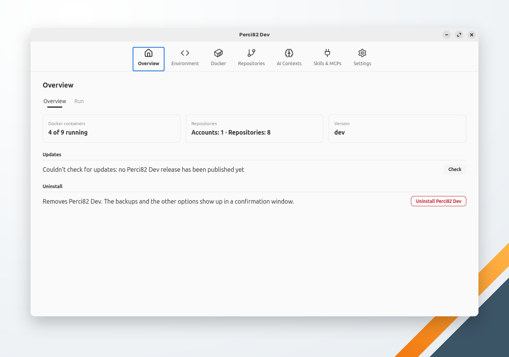

🌐 [Português](../../pt-br/dev/overview.md) | **English** | 🏠 [Index](../index.md)

---

# Overview

The first screen of Perci82 Dev: a summary of the Docker containers and repositories, its version, its updates and its uninstall.



## The window

Perci82 Dev's sections are tabs at the top of the window: **Overview**, **Environment**, **Docker**, **Repositories**, **AI Contexts**, **Skills & MCPs** and **Settings**. Each section has a side list with its screens; in **Repositories**, the Git accounts are grouped under **Accounts**, one item per account. Screens that run actions have their own tabs plus **Run**, which shows the running action: its progress bar and the commands' output.

Only one action runs at a time, and the window doesn't close while one runs. Actions that need administrator rights never run in Perci82 Dev and Perci82 System at once: while one app runs such an action, the other refuses with a message naming that app.

Perci82 Dev runs once per session: opening it again brings the running window to the front.

## Cards

| Card | Shows |
|---|---|
| **Docker containers** | How many of the registered containers are running (e.g. "2 of 3 running"); **None** without containers, **Docker unreachable** when Docker can't be queried |
| **Repositories** | The number of Git accounts and of repositories found in their folders; **No account** without accounts |
| **Version** | Perci82 Dev's version, with an **up to date** or **update available** badge after each check |

## Updates

The app checks for a newer release when the screen opens (again at most every 10 minutes); **Check** checks at once. It reads Perci82 Dev's newest version from the package repository site (`https://oito2.github.io/perci82/latest/dev.json`) and, when that fails, from Perci82 Dev's releases on GitHub (tags `dev-vX.Y.Z`).

When a newer release exists and the app was installed from its package, the screen shows the command that installs it, with **Copy**. Run it in a terminal:

```bash
sudo apt update && sudo apt install --only-upgrade perci82-dev   # apt
sudo dnf upgrade --refresh perci82-dev                             # dnf
```

`apt upgrade` and `dnf upgrade` also update it with the rest of the system. The app never replaces its own files. A build from source reports the version `dev` and shows no command.

## Uninstall

**Uninstall Perci82 Dev** opens a confirmation window with the backups of Docker, repositories and AI contexts, and the options to remove the Docker containers and Perci82 Dev's settings. When it finishes, a window shows the command that removes the package. See [Uninstalling](uninstallation.md).

## System tray

With **Show Perci82 Dev in the system tray** on ([Settings](settings.md#system-tray)), Perci82 Dev puts an icon in the system tray, drawn in the panel's own text color. A right click opens its menu (on GNOME, a single left click too); a left click shows the main window (on GNOME, a double click). The menu has:

- **Open Application** — shows the main window.
- **Containers** — opens a compact window with **Docker → Manage Containers** only, and an **Open Application** button.
- **Quit** — quits Perci82 Dev (refused while an action runs).

Closing the main window then hides it in the tray instead of quitting, and Perci82 Dev starts hidden in the tray when you log in.
