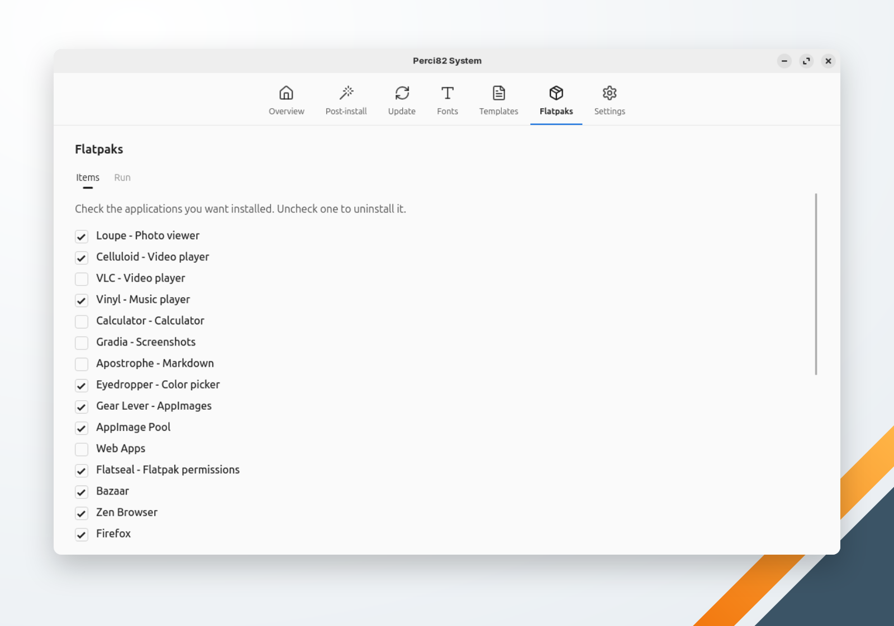

🌐 [Português](../../pt-br/system/flatpaks.md) | **English** | 🏠 [Index](../index.md)

---

# Flatpaks

Installs and removes desktop applications from [Flathub](https://flathub.org). Each checkbox shows whether the application is installed: check the ones you want, uncheck the ones to remove, then click **Run**.

| Application | Flatpak ID |
|---|---|
| Loupe — Photo viewer | `org.gnome.Loupe` |
| Celluloid — Video player | `io.github.celluloid_player.Celluloid` |
| VLC — Video player | `org.videolan.VLC` |
| Vinyl — Music player | `page.codeberg.M23Snezhok.Vinyl` |
| Calculator — Calculator | `org.gnome.Calculator` |
| Gradia — Screenshots | `be.alexandervanhee.gradia` |
| Apostrophe — Markdown | `org.gnome.gitlab.somas.Apostrophe` |
| Eyedropper — Color picker | `com.github.finefindus.eyedropper` |
| Gear Lever — AppImages | `it.mijorus.gearlever` |
| AppImage Pool | `io.github.prateekmedia.appimagepool` |
| Web Apps | `net.codelogistics.webapps` |
| Flatseal — Flatpak permissions | `com.github.tchx84.Flatseal` |
| Bazaar | `io.github.kolunmi.Bazaar` |
| Zen Browser | `app.zen_browser.zen` |
| Firefox | `org.mozilla.firefox` |
| Chromium | `org.chromium.Chromium` |
| FileZilla | `org.filezillaproject.Filezilla` |
| Inkscape | `org.inkscape.Inkscape` |
| Krita | `org.kde.krita` |
| Penpot | `com.authormore.penpotdesktop` |
| LibreOffice | `org.libreoffice.LibreOffice` |
| OnlyOffice | `org.onlyoffice.desktopeditors` |
| AnyDesk | `com.anydesk.Anydesk` |
| DBeaver Community | `io.dbeaver.DBeaverCommunity` (installed with network access granted) |
| Beekeeper Studio | `io.beekeeperstudio.Studio` |
| Meld — File comparison | `org.gnome.meld` |
| Tomatillo — Pomodoro | `io.github.diegopvlk.Tomatillo` |
| Extension Manager (GNOME) | `com.mattjakeman.ExtensionManager` |

When Flatpak or the Flathub remote is missing, the run installs and adds them first. Applications are installed in the scope chosen in [Settings](settings.md): **System (every user)**, the default, asks for your password; **User (only you)** doesn't. An application that fails doesn't stop the others: the run ends listing the ones that failed.
