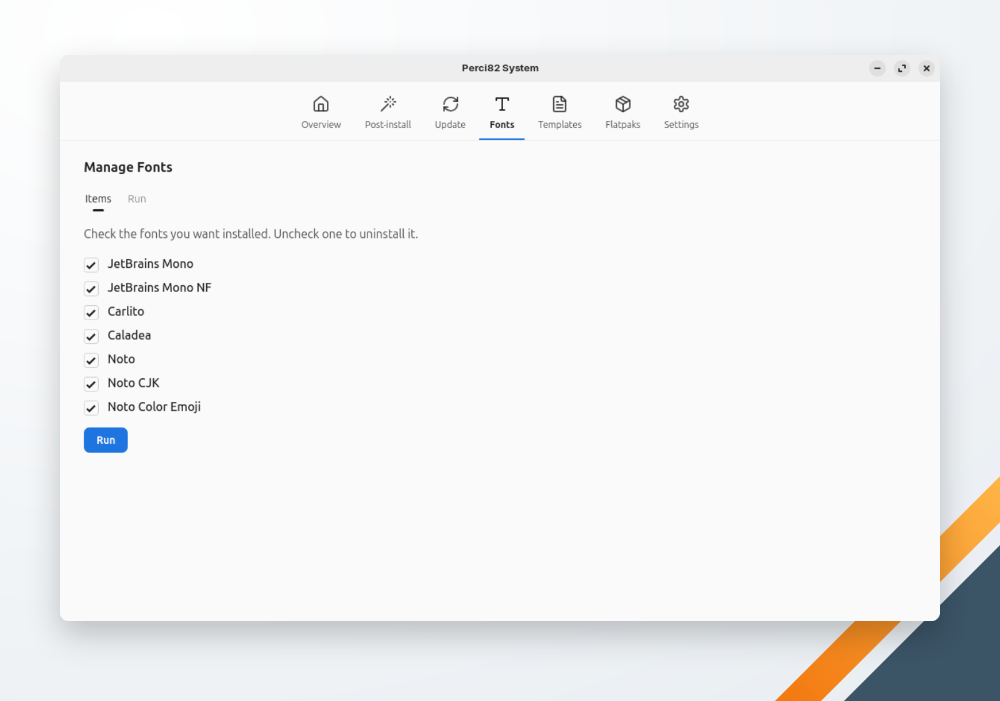

🌐 [Português](../../pt-br/system/fonts.md) | **English** | 🏠 [Index](../index.md)

---

# Manage Fonts

Installs and removes fonts. Each checkbox shows whether the font is installed: check the fonts you want, uncheck the ones to remove, then click **Run**.

| Font | Source |
|---|---|
| JetBrains Mono | Downloaded from the JetBrains release on GitHub (SHA-256 checked) into `~/.local/share/fonts/perci/jetbrains-mono/` |
| JetBrains Mono NF | The Nerd Fonts build, downloaded from GitHub (SHA-256 checked) into `~/.local/share/fonts/perci/jetbrains-mono-nf/` |
| Carlito | Package `fonts-crosextra-carlito` (`apt`) or `google-carlito-fonts` (`dnf`) |
| Caladea | Package `fonts-crosextra-caladea` (`apt`) or `google-crosextra-caladea-fonts` (`dnf`) |
| Noto | Package `fonts-noto-core` (`apt`) or `google-noto-sans-fonts` (`dnf`) |
| Noto CJK | Package `fonts-noto-cjk` (`apt`) or `google-noto-sans-cjk-fonts` (`dnf`) |
| Noto Color Emoji | Package `fonts-noto-color-emoji` (`apt`) or `google-noto-color-emoji-fonts` (`dnf`) |

Package fonts need your password; the downloaded ones go to your home folder and don't. The font cache is refreshed at the end. A font that fails doesn't stop the others: the run ends listing the ones that failed.
