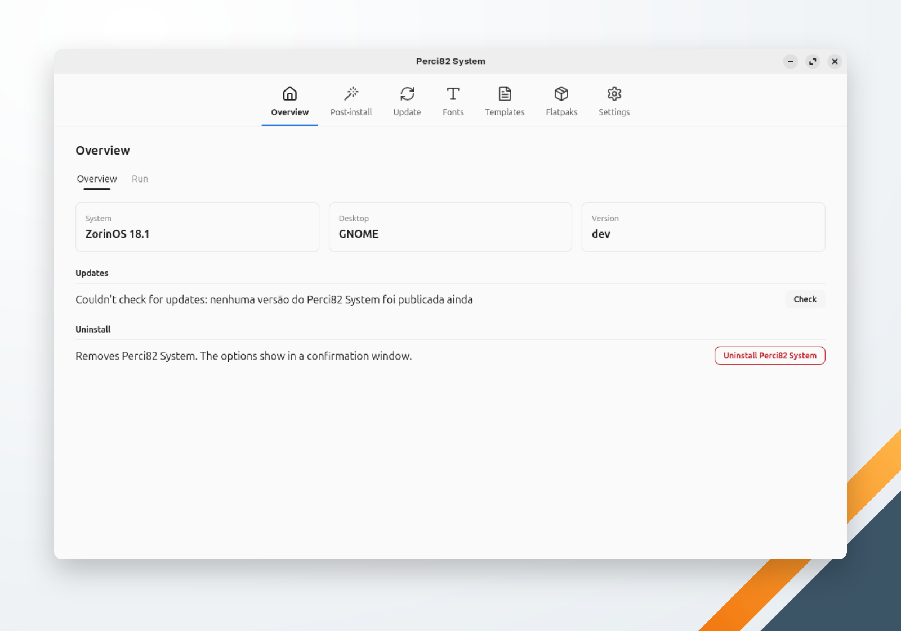

🌐 [Português](../../pt-br/system/overview.md) | **English** | 🏠 [Index](../index.md)

---

# Overview

The first screen of Perci82 System: what it detected, its version, its updates and its uninstall.

<!-- TODO: capture a screenshot of Perci82 System's Overview -->

## The window

Perci82 System's sections are tabs at the top of the window: **Overview**, **Post-install**, **Update**, **Fonts**, **Templates**, **Flatpaks** and **Settings**. Screens that run actions have two inner tabs:

- **Items** — what to apply, install or remove, and the button that starts it.
- **Execution** — the running action: its progress bar and the commands' output.

Only one action runs at a time, and the window doesn't close while one runs. Actions that need administrator rights never run in Perci82 System and Perci82 Dev at once: while one app runs such an action, the other refuses with a message naming that app.

## Cards

| Card | Shows |
|---|---|
| **System** | The [post-install](post-install.md) profile of the machine (e.g. "ZorinOS 18.1 Lite"); on a system without a profile, the distribution's name and version |
| **Desktop** | The desktop environment (GNOME, KDE Plasma, Cinnamon, XFCE, Budgie, COSMIC…) |
| **Version** | Perci82 System's version, with an **up to date** or **update available** badge after each check |

## Updates

The app checks for a newer release when the screen opens (again at most every 10 minutes); **Check** checks at once. It looks only at Perci82 System's own releases (tags `system-vX.Y.Z`) on GitHub.

When a newer release exists, **Update** appears. It downloads the new binary, checks its SHA-256 against the release's `checksums.txt`, replaces the installed binary and shows the progress in the **Execution** tab. Restart the app afterwards.

A build from source reports the version `dev` and can't update itself.

## Uninstall

**Uninstall Perci82 System** opens a confirmation window. It removes the binary, the application menu entry and the icons; **Also remove the Perci82 System settings** (unchecked each time the window opens) removes its settings too. See [Uninstalling](uninstallation.md).
