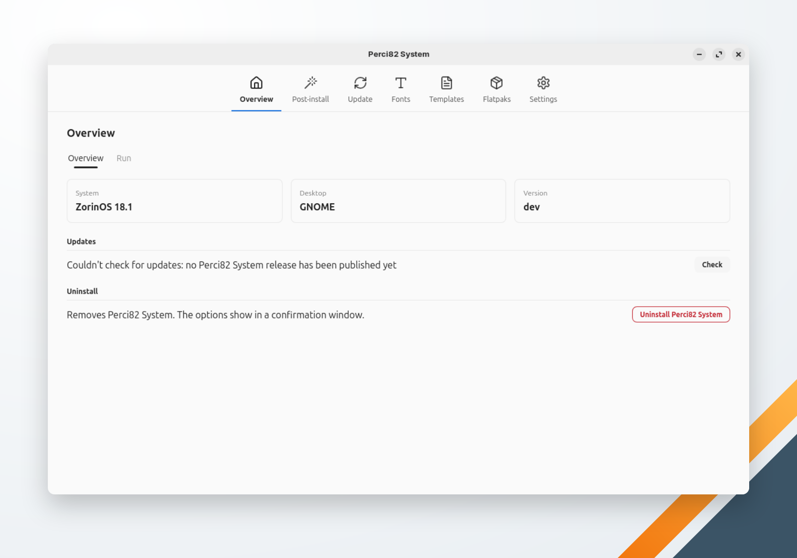

🌐 [Português](../../pt-br/system/overview.md) | **English** | 🏠 [Index](../index.md)

---

# Overview

The first screen of Perci82 System: what it detected, its version, its updates and its uninstall.



## The window

Perci82 System's sections are tabs at the top of the window: **Overview**, **Post-install**, **Update**, **Fonts**, **Templates**, **Flatpaks** and **Settings**. Screens that run actions have two inner tabs:

- **Items** — what to apply, install or remove, and the button that starts it.
- **Run** — the running action: its progress bar and the commands' output.

Only one action runs at a time, and the window doesn't close while one runs. Actions that need administrator rights never run in Perci82 System and Perci82 Dev at once: while one app runs such an action, the other refuses with a message naming that app.

## Cards

| Card | Shows |
|---|---|
| **System** | The [post-install](post-install.md) profile of the machine (e.g. "ZorinOS 18.1 Lite"); on a system without a profile, the distribution's name and version |
| **Desktop** | The desktop environment (GNOME, KDE Plasma, Cinnamon, XFCE, Budgie, COSMIC…) |
| **Version** | Perci82 System's version, with an **up to date** or **update available** badge after each check |

## Updates

The app checks for a newer release when the screen opens (again at most every 10 minutes); **Check** checks at once. It reads Perci82 System's newest version from the package repository site (`https://oito2.github.io/perci82/latest/system.json`) and, when that fails, from Perci82 System's releases on GitHub (tags `system-vX.Y.Z`).

When a newer release exists and the app was installed from its package, the screen shows the command that installs it, with **Copy**. Run it in a terminal:

```bash
sudo apt update && sudo apt install --only-upgrade perci82-system   # apt
sudo dnf upgrade --refresh perci82-system                             # dnf
```

`apt upgrade` and `dnf upgrade` also update it with the rest of the system. The app never replaces its own files. A build from source reports the version `dev` and shows no command.

## Uninstall

**Uninstall Perci82 System** opens a confirmation window. **Also remove the Perci82 System settings** (unchecked each time the window opens) removes its settings; then a window shows the command that removes the package — the binary, the application menu entry and the icons. See [Uninstalling](uninstallation.md).
