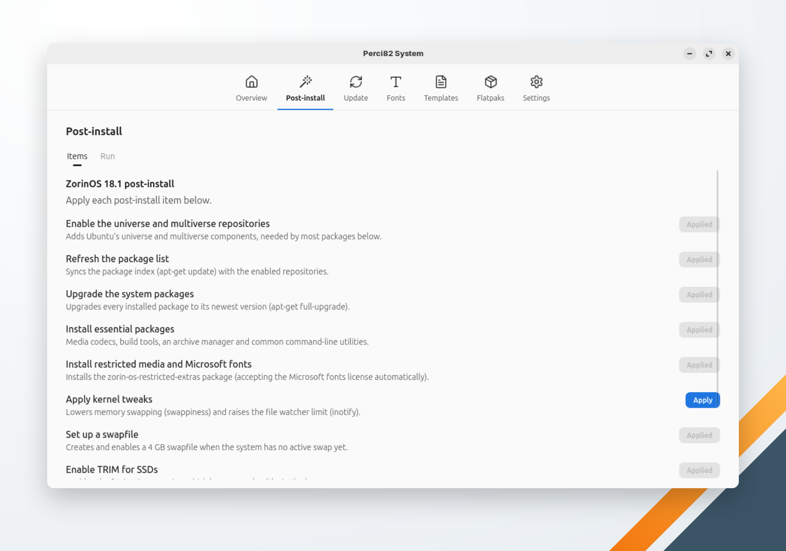

🌐 [Português](../../pt-br/system/post-install.md) | **English** | 🏠 [Index](../index.md)

---

# Post-install

Recommended setup for a freshly installed system, item by item. Each item has its own **Apply** button.

## Supported systems

The screen shows the items of the profile that matches the machine (`/etc/os-release` and the desktop environment). On any other system it says the system is not supported; the other screens still work.

| Profile | Matches |
|---|---|
| Ubuntu 24.04 / Ubuntu 26.04 | Ubuntu 24.04 or 26.04 with any desktop but Budgie |
| Ubuntu Budgie 24.04 / Ubuntu Budgie 26.04 | Ubuntu 24.04 or 26.04 with Budgie |
| Linux Mint Cinnamon / Linux Mint XFCE | Linux Mint with Cinnamon or XFCE (any version) |
| ZorinOS 18.1 / ZorinOS 18.1 Lite | Zorin OS with GNOME (Core) or XFCE (Lite) (any version) |
| Fedora 44 / Fedora 44 Budgie | Fedora with any desktop, or with Budgie (any version) |
| Pop!_OS 24.04 COSMIC | Pop!_OS 24.04 with COSMIC |

## Items

Items are listed in order. Some require another one first: they show **Requires: …** and their button stays off until that item is applied. Applied items show **Applied**.

| Item | What it does | Profiles |
|---|---|---|
| Enable the universe and multiverse repositories | Adds Ubuntu's universe and multiverse components | Ubuntu, Ubuntu Budgie, Mint, Zorin |
| Refresh the package list | `apt-get update` | Ubuntu, Ubuntu Budgie, Mint, Zorin |
| Upgrade the system packages | `apt-get full-upgrade` | Ubuntu, Ubuntu Budgie, Mint, Zorin, Pop!_OS |
| Apply backports-budgie | Adds the backports-budgie PPA and applies its upgrades; take a Timeshift snapshot first | Ubuntu Budgie 26.04 |
| Install essential packages (and codecs) | Build tools and common command-line utilities (the set depends on the profile, e.g. Timeshift on Ubuntu, Mint and Pop!_OS); on Ubuntu and Ubuntu Budgie also the restricted codecs, accepting the Microsoft fonts license | All |
| Install Microsoft fonts | `ttf-mscorefonts-installer`, accepting its license | Mint |
| Install restricted media and Microsoft fonts | `zorin-os-restricted-extras`, accepting the Microsoft fonts license | Zorin |
| Install multimedia codecs | Ubuntu's restricted extras and GStreamer plugins on Pop!_OS; the full `ffmpeg` and the multimedia group on Fedora | Pop!_OS, Fedora |
| Upgrade the base system | `dnf upgrade --refresh` | Fedora |
| Enable RPM Fusion | Adds the RPM Fusion free and nonfree repositories | Fedora |
| Install unrar | From RPM Fusion nonfree | Fedora |
| Install NTFS support | `ntfs-3g` | Fedora |
| Apply kernel tweaks | Lowers swappiness and raises the inotify watch limit (`/etc/sysctl.d/99-perci.conf`) | All |
| Set up a swapfile | Creates and enables a 4 GB `/swapfile` when there is no active swap | Ubuntu, Ubuntu Budgie, Mint, Zorin |
| Enable TRIM for SSDs | Enables `fstrim.timer` | All |
| Intel video driver (VA-API) / AMD video driver (VA-API) | Hardware video acceleration — apply only the one for your GPU | All |
| Set up Flatpak / Install essential Flatpaks | Installs Flatpak, adds Flathub and installs VLC and a web app manager (only the web app manager on Ubuntu Budgie 26.04) | Ubuntu, Ubuntu Budgie, Mint, Pop!_OS |
| Detect additional drivers | `ubuntu-drivers autoinstall` (e.g. NVIDIA) | Ubuntu, Ubuntu Budgie, Mint |
| Clean up unneeded packages | `dnf autoremove` and `dnf clean all` | Fedora |

The Flatpak items use the scope chosen in [Settings](settings.md).

## How "Applied" is decided

Items whose result can be seen on the system (a package, a repository, a setting) are checked there. Items that leave nothing to check (such as refreshing the package list) count as applied once they ran successfully; that record is saved in `~/.perci/config.yaml` with the machine's `/etc/machine-id`, so records from a reinstalled system don't count.

Post-install has no undo: to revert an item, use your distribution's tools.
