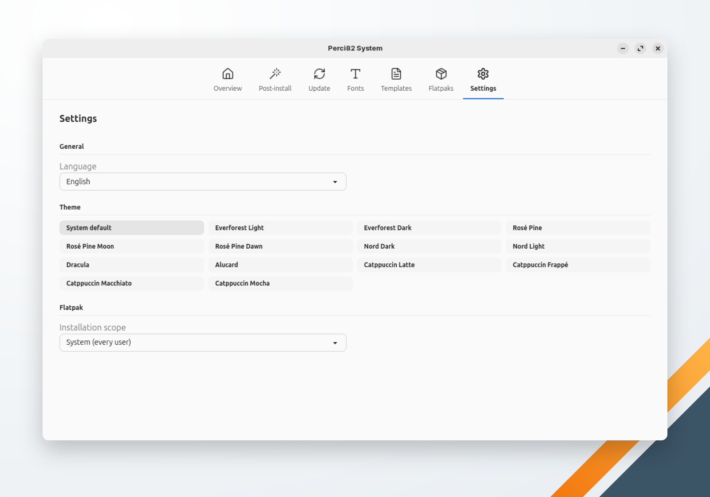

🌐 [Português](../../pt-br/system/settings.md) | **English** | 🏠 [Index](../index.md)

---

# Settings

Perci82 System's own preferences. Every change is saved and applied at once; there is no Save button.

## General

**Language** chooses the language of the whole app, including the progress messages of its actions:

- **System default** — Portuguese when the system language (`LC_ALL`, `LC_MESSAGES` or `LANG`) is Portuguese, English otherwise.
- **Português (Brasil)**.
- **English**.

The switch applies at once, without a restart. Technical error details are shown in English. Perci82 Dev has its own language setting.

## Theme

- **System default** follows the desktop's light or dark preference, accent color and high contrast, and changes with them while the app is open.
- The 13 oito2 presets: Everforest Light, Everforest Dark, Rosé Pine, Rosé Pine Moon, Rosé Pine Dawn, Nord Dark, Nord Light, Dracula, Alucard, Catppuccin Latte, Catppuccin Frappé, Catppuccin Macchiato and Catppuccin Mocha.

Perci82 System keeps its theme apart from Perci82 Dev's.

## Flatpak

**Installation scope** is where [Flatpaks](flatpaks.md) and the Flatpak items of [Post-install](post-install.md) install applications:

- **System (every user)** — the default; asks for your password.
- **User (only you)** — installs in your home folder, without a password.

## Where the settings are saved

In `~/.perci/config.yaml`, shared with Perci82 Dev. Each app writes only its own keys and keeps the others as they are. A `config.yaml` that is a symbolic link (a dotfiles manager's) stays one: its target is written.

| Key | Holds |
|---|---|
| `system_language` | The language: `system`, `pt-BR` or `en` |
| `system_gui_theme` | The theme |
| `flatpak_scope` | `system` or `user` |
| `postinstall_applied` | The post-install items that ran successfully, per profile |
| `postinstall_machine_id` | The `/etc/machine-id` those records belong to |
