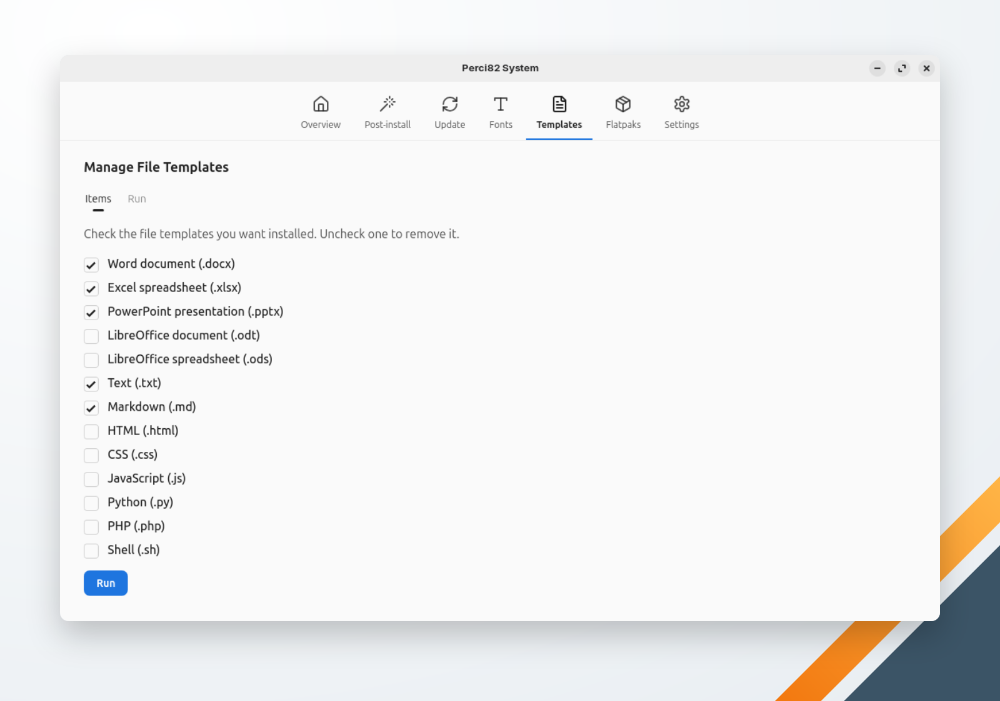

🌐 [Português](../../pt-br/system/templates.md) | **English** | 🏠 [Index](../index.md)

---

# Manage File Templates

Adds empty file templates to your templates folder, so the file manager's **New Document** menu can create them. Check the templates you want, uncheck the ones to remove, then click **Run**.

<!-- TODO: capture a screenshot of the Manage File Templates screen -->

| Template | File |
|---|---|
| Word document (.docx) | `Documento.docx` |
| Excel spreadsheet (.xlsx) | `Planilha.xlsx` |
| PowerPoint presentation (.pptx) | `Apresentacao.pptx` |
| LibreOffice document (.odt) | `Documento.odt` |
| LibreOffice spreadsheet (.ods) | `Planilha.ods` |
| Text (.txt) | `Texto.txt` |
| Markdown (.md) | `Documento.md` |
| HTML (.html) | `HTML.html` |
| CSS (.css) | `Estilo.css` |
| JavaScript (.js) | `Script.js` |
| Python (.py) | `Script.py` |
| PHP (.php) | `PHP.php` |
| Shell (.sh) | `Shell.sh` |

The templates folder is the one `xdg-user-dir TEMPLATES` reports; without it, `~/Modelos` when that folder exists, else `~/Templates`. A file that already exists is kept as it is. No password is needed.
