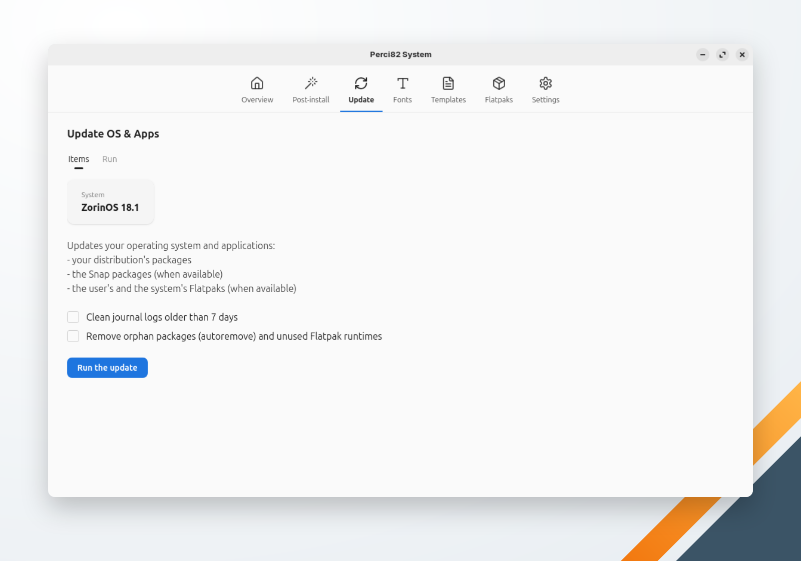

🌐 [Português](../../pt-br/system/update.md) | **English** | 🏠 [Index](../index.md)

---

# Update OS & Apps

Updates the operating system and the applications in one run, asking for your password once.

## Steps

**Run the update** runs, in order, the steps that apply to the machine:

| Step | `apt` systems | `dnf` systems |
|---|---|---|
| Packages | `apt-get update`, `apt-get full-upgrade`, `apt-get autoclean` | `dnf upgrade --refresh` |
| Snap packages (when `snap` is installed) | `snap refresh` | `snap refresh` |
| System Flatpaks (when Flatpak is installed) | `flatpak update --system` | `flatpak update --system` |
| User Flatpaks (when Flatpak is installed) | `flatpak update --user` | `flatpak update --user` |

Every privileged step runs as one batch, so the password is asked once. A step that fails doesn't stop the others: the run ends with a warning naming what failed.

## Options

Both are unchecked by default:

- **Clean journal logs older than 7 days** — `journalctl --vacuum-time=7d`.
- **Remove orphan packages (autoremove) and unused Flatpak runtimes** — `apt-get autoremove` or `dnf autoremove`, and `flatpak uninstall --unused` for the system and the user.

## Unsupported systems

On a system with neither `apt` nor `dnf`, the update stops with "Unsupported distribution: no known package manager."
