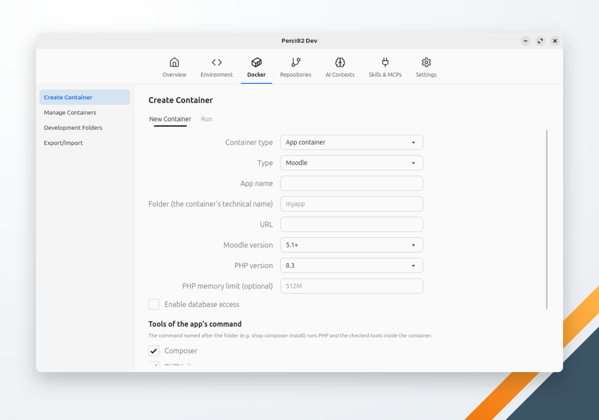

🌐 [English](../../en/dev/docker.md) | **Português** | 🏠 [Índice](../index.md)

---

# Docker

Cria e gerencia um ambiente de desenvolvimento local no Docker: um proxy reverso Nginx que serve cada aplicativo por HTTPS em `https://<app>.localhost`, um banco MariaDB compartilhado, um contêiner por aplicativo e, se você quiser, um contêiner Selenium compartilhado para os testes Behat do Moodle. A lista lateral tem quatro telas: **Criar Contêiner**, **Gerenciar Contêineres**, **Pastas de Desenvolvimento** e **Exportar/Importar**.



## O ambiente

Todos os contêineres entram na rede Docker `docker-php-network` e reiniciam junto com o Docker (`--restart unless-stopped`), menos o Selenium, que fica parado depois que o computador reinicia até você iniciá-lo. Nginx, MariaDB e Selenium existem uma vez cada; os aplicativos são identificados pelo nome da pasta, que também é o nome do contêiner.

| Contêiner | Imagem | Publicado no host | O que faz |
|---|---|---|---|
| Nginx | `nginx:1.26-alpine` | `127.0.0.1:80` e `127.0.0.1:443` | Encaminha a URL `<nome>.localhost` de cada aplicativo ao contêiner dele; qualquer outro nome `*.localhost` responde 404 |
| MariaDB | `mariadb:11.4` | `127.0.0.1:3306` | Servidor de banco compartilhado, com o banco `dev_db` |
| Selenium (opcional) | `selenium/standalone-chrome:4.52.0-20261101` | `127.0.0.1:7900` (noVNC) | Chrome para os cenários `@javascript` do [Behat](#behat) de todos os aplicativos Moodle |
| Aplicativo | construída pelo Perci82 Dev (veja abaixo) | — | Roda o PHP (php-fpm) e/ou o servidor de desenvolvimento Node do aplicativo |

O certificado HTTPS é gerado com o mkcert quando o contêiner Nginx é criado. Ele cobre `*.localhost`, `localhost` e a URL de cada aplicativo pelo nome, e é gerado de novo quando falta um nome ou quando expira em menos de 30 dias. A autoridade certificadora do mkcert também é registrada nos navegadores instalados como Flatpak (isso precisa do `certutil`, que o pré-requisito Mkcert traz); reinicie esses navegadores depois. O roteamento do Nginx é regravado e recarregado sem downtime sempre que um aplicativo é criado, editado ou removido.

### Tipos de aplicativo

| Tipo | Imagem | Raiz do projeto no contêiner | Como o Nginx serve |
|---|---|---|---|
| Moodle | `perci-php<versão>` | `/var/www/html`; moodledata em `/var/www/data` | Arquivos e PHP; a raiz web é `public/` no Moodle 5.1+ |
| PHP | `perci-php<versão>` | `/var/www/html` | Arquivos e PHP |
| Genérico | `perci-php<versão>` | `/var/www/html` | Arquivos e PHP (configurado igual ao PHP) |
| Node | `perci-node<versão>` | `/app` | Repassa toda requisição à porta do servidor de desenvolvimento (WebSockets incluídos, para o hot reload) |
| PHP + Node | `perci-php<versão>-node<versão>` | `api/` em `/var/www/html`, `app/` em `/app` | `/api/` vai para o PHP; o resto é repassado ao servidor de desenvolvimento |

As imagens PHP são construídas no primeiro uso de cada versão do PHP e trazem Composer, PHPUnit, PHP_CodeSniffer, Xdebug, Redis e o padrão de código do Moodle (moodle-cs 3.9.0, com PHPCSExtra 1.5.1 e PHPCSUtils 1.2.3), além do locale `en_AU.UTF-8`, exigido pelo PHPUnit do Moodle, e do locale `pt_BR.UTF-8`. O PHP roda como `www-data` com o UID do seu usuário, e o Node roda como o usuário `node` da imagem com o seu UID, então os arquivos que eles gravam no projeto continuam seus. Num contêiner PHP + Node, o supervisord roda o php-fpm, o servidor de desenvolvimento (em `app/`) e o worker opcional (em `api/`). As ferramentas vêm em versões fixas, conferidas por SHA-256: versões novas chegam com uma atualização do Perci82 Dev, e **Atualizar imagem** então reconstrói a imagem com elas.

Com **Habilitar acesso ao banco** marcado, o contêiner do aplicativo recebe as variáveis `DB_HOST=mariadb`, `DB_PORT=3306`, `DB_USER`, `DB_PASS` (as credenciais do MariaDB) e `DB_NAME=dev_db`. Nenhum arquivo de configuração do aplicativo é gerado a partir delas.

### Onde ficam os arquivos

O workspace é `~/workspace`, a não ser que outra pasta esteja definida em **Caminho do Workspace** nas [Configurações](settings.md).

| Caminho | Conteúdo |
|---|---|
| `<workspace>/localhost/html/<pasta>` | A raiz do projeto do aplicativo (PHP + Node: `api/` e `app/` dentro dela) |
| `<workspace>/localhost/data/<pasta>` | O moodledata do Moodle (só Moodle; outros usuários não têm acesso) |
| `<workspace>/localhost/logs/<pasta>` | O `error.log` do PHP (todos os tipos menos Node) |
| `<workspace>/localhost/logs/nginx` | Os logs do Nginx |
| `<workspace>/localhost/databases/mariadb` | Os dados do MariaDB |
| `~/.perci/appstack/nginx/default.conf` | O roteamento gerado do Nginx |
| `~/.perci/appstack/certs` | O certificado `*.localhost` |
| `~/.perci/appstack/mariadb/init` | O script de inicialização do MariaDB (dá ao usuário todos os privilégios) |
| `~/.perci/appstack/php-conf/<pasta>` | O limite de memória PHP do aplicativo |
| `~/.perci/appstack/backups` | Backups do MariaDB feitos antes de uma atualização de imagem |
| `~/.local/bin/<pasta>` | O [comando do app](#o-comando-do-app) |
| `/etc/systemd/system/*.mount` | As montagens das [Pastas de Desenvolvimento](#pastas-de-desenvolvimento) |

As configurações dos contêineres ficam em `~/.perci/config.yaml`.

## Criar Contêiner

Escolha o **Tipo de contêiner**: **Nginx**, **MariaDB**, **Selenium**, **Contêiner Aplicativo** (e então o **Tipo**: **Moodle**, **PHP** ou **Genérico**), **Node** ou **PHP + Node**. Nginx, MariaDB e Selenium ficam desabilitados depois de criados. Clique em **Criar Contêiner**; o andamento aparece no log de execução.

O Docker precisa estar instalado. O contêiner Nginx também precisa do mkcert, instalado em [Ambiente → Pré-requisitos](environment.md). A primeira criação do Nginx roda `mkcert -install`, que pode pedir a senha de administrador fora do Perci82 Dev: a tela avisa, e se travar, rode `mkcert -install` uma vez num terminal antes de clicar em **Criar Contêiner**.

O **Nginx** e o **Selenium** não têm campos. O **MariaDB** pede **Usuário do banco** (letras, números e `_`, de 1 a 32 caracteres; `dev_user` por padrão) e **Senha** (uma aleatória vem preenchida). Uma senha de root é gerada e salva. Quando a pasta de dados já tem um banco criado com outras credenciais, a criação é recusada: o MariaDB ignora credenciais novas em dados existentes.

Campos do aplicativo:

| Campo | Tipos | Observações |
|---|---|---|
| **Nome do aplicativo** | todos | Nome exibido |
| **Pasta (nome técnico do contêiner)** | todos | Letras, números, `-` e `_`, começando por letra ou número (de 2 a 64 caracteres, como o Docker exige para o nome de um contêiner); `nginx`, `mariadb` e `selenium` são reservados. Dá nome à pasta do projeto, ao contêiner e ao comando |
| **URL** | todos | Um rótulo seguido de `.localhost`; preenchida a partir da pasta até você editá-la; uma URL por aplicativo |
| **Versão do Moodle** | Moodle | `3.x`, `4.1`, `4.2-4.3`, `4.4-4.5`, `5.0` ou `5.1+` |
| **Versão PHP** | Moodle, PHP, Genérico, PHP + Node | De `7.4` a `8.4`; no Moodle, só as versões que aquela versão do Moodle suporta |
| **Limite de memória PHP (opcional)** | Moodle, PHP, Genérico, PHP + Node | Como `512M`, `1G` ou `-1`; vazio mantém `512M` |
| **Versão Node** | Node, PHP + Node | `22`, `24` ou `26` |
| **Comando de start** | Node, PHP + Node | O comando do servidor de desenvolvimento (`npm run dev` por padrão). No PHP + Node ele não passa por um shell: para `&&` ou pipes, use `sh -c "…"` |
| **Porta** | Node, PHP + Node | A porta do servidor de desenvolvimento (`5173` por padrão), de 1024 a 65535, menos 3306 e 9000 |
| **Comando do worker (opcional)** | PHP + Node | Um processo em segundo plano (por exemplo, um consumidor de fila), rodado com `sh -c` em `api/` |
| **Habilitar acesso ao banco** | Moodle, PHP, Genérico, PHP + Node | Disponível depois que o MariaDB existe |
| **Site de testes do Behat** | Moodle | Desligado por padrão. Serve a pasta do aplicativo também em `http://<pasta>-behat.test` para o [Behat](#behat); a pasta precisa então ter até 57 caracteres, só com letras, números e hífen |
| **Ferramentas do comando do app** | todos os tipos menos Node | Lista: **Composer**, **PHPUnit**, **PHP_CodeSniffer (phpcs e phpcbf)** e, no Moodle, **moodle-cs (padrão de código do Moodle no phpcs)**. Todas marcadas por padrão |

Versões do Moodle e PHP:

| Versão do Moodle | PHP |
|---|---|
| 3.x | 7.4 |
| 4.1 | 7.4, 8.0, 8.1 |
| 4.2-4.3 | 8.0, 8.1, 8.2 |
| 4.4-4.5 | 8.1, 8.2, 8.3 |
| 5.0 | 8.2, 8.3, 8.4 |
| 5.1+ | 8.3, 8.4 |

Criar um aplicativo cria as pastas dele, constrói a imagem quando aquela versão é usada pela primeira vez (pode levar alguns minutos), inicia o contêiner, grava o comando dele e atualiza o roteamento do Nginx. O Perci82 Dev não instala o código do aplicativo: coloque-o na pasta do projeto.

## Gerenciar Contêineres

Uma tabela com cada contêiner (os aplicativos aparecem como `<nome> (<tipo>)`), o status e as ações. O status é o do Docker: **rodando**, **reiniciando**, **pausado**, **criado**, **parado**, **morto**, **não encontrado** ou **Docker inacessível**.

| Ação | Contêineres | O que faz |
|---|---|---|
| **Iniciar** / **Parar** / **Reiniciar** | todos | Inicia, para ou reinicia o contêiner |
| **Recriar** | todos | Remove o contêiner e cria de novo com os parâmetros salvos (e grava de novo o comando do app) |
| **Atualizar imagem** | todos | Baixa ou reconstrói a imagem na correção mais recente da mesma versão e recria os contêineres que a usam; nada é recriado quando nada mudou. A imagem do Selenium tem uma tag fixa, que só muda com uma atualização do Perci82 Dev |
| **Criar o comando do app** | aplicativos que ainda têm os comandos antigos `php-<pasta>`, `composer-<pasta>`… | Troca-os pelo [comando do app](#o-comando-do-app), sem recriar o contêiner |
| **Configuração do Behat** | aplicativos Moodle com **Site de testes do Behat** ligado | Mostra as linhas a acrescentar ao `config.php` do aplicativo e os comandos que inicializam o site de testes e rodam os cenários, cada um com **Copiar** (veja [Behat](#behat)) |
| **Ver Logs** | todos | Mostra as últimas 200 linhas do contêiner; **Atualizar** busca de novo e **Exportar** salva num arquivo `.txt` |
| **Editar** | MariaDB e aplicativos | Abre os campos da criação com os valores atuais. Num aplicativo a pasta não muda; a imagem é construída e os dados conferidos antes de o contêiner em execução ser substituído. No MariaDB, credenciais novas são recusadas quando os dados foram criados com outras |
| **Backup** | MariaDB | Salva todos os bancos num arquivo `.sql` que você escolhe (o MariaDB precisa estar rodando) |
| **Restore** | MariaDB | Carrega um arquivo `.sql`, sobrescrevendo os dados atuais do MariaDB (o MariaDB precisa estar rodando) |
| **Remover** | todos | Remove o contêiner e as configurações dele. As pastas de projeto, dados e banco ficam no disco. Num aplicativo, o comando e os comandos antigos dele são apagados e o roteamento do Nginx é atualizado |

**Atualizar imagens**, acima da tabela, atualiza do mesmo jeito as imagens de todos os contêineres. Arquivos, bancos e pastas montadas são mantidos. Antes de o MariaDB ser recriado por uma atualização, um backup completo é salvo em `~/.perci/appstack/backups`; para isso o MariaDB precisa estar rodando, senão a atualização para.

## O comando do app

Cada aplicativo ganha um comando com o nome da pasta dele em `~/.local/bin`. Ele roda uma ferramenta dentro do contêiner do aplicativo:

```bash
loja composer install
mdle-401 phpcs --standard=moodle local/x
site npm test
loja -v
```

O primeiro argumento escolhe a ferramenta quando é um dos subcomandos do tipo; qualquer outra coisa roda pelo `php` (`node` num aplicativo Node), como `loja -v` roda `php -v`.

| Tipo | Subcomandos | Senão | Roda como | Pastas do projeto no contêiner |
|---|---|---|---|---|
| Moodle, PHP, Genérico | `composer`, `phpunit`, `phpcs`, `phpcbf` | `php` | `www-data` (o seu UID) | `/var/www/html` |
| Node | `npm` | `node` | `node` (o seu UID) | `/app` |
| PHP + Node | `composer`, `phpunit`, `phpcs`, `phpcbf`, `npm` | `php` | `www-data` (o seu UID) | `api/` → `/var/www/html`, `app/` → `/app` |

- **Lista de ferramentas:** uma ferramenta desmarcada em **Ferramentas do comando do app** (salva como `disabled_tools`) responde `<ferramenta>: ferramenta não ativada neste app (<app>) — ative em Docker → Gerenciar Contêineres → Editar` e sai com código 2. **PHP_CodeSniffer** vale para `phpcs` e `phpcbf`; o `npm` está sempre ativo.
- **moodle-cs:** num aplicativo Moodle com **moodle-cs** marcado, `phpcs` e `phpcbf` conhecem o padrão do Moodle (`--standard=moodle`). Depois de trocar um aplicativo antigo para o comando, o moodle-cs fica disponível quando o contêiner é recriado ou a imagem dele é atualizada.
- **Pasta de trabalho:** quando a pasta atual fica dentro do projeto do aplicativo, o comando roda na pasta correspondente dentro do contêiner. Fora dele, roda na raiz do projeto e avisa `<app>: a pasta atual fica fora do app — rodando em <pasta>`. Argumentos que são caminhos dentro do projeto são convertidos para os caminhos do contêiner.
- **Terminal:** o comando é interativo num terminal e também funciona em scripts e pipes.
- **Conflitos:** quando outro programa já tem o nome do aplicativo (um arquivo em `~/.local/bin` que o Perci82 Dev não criou, ou um comando no `PATH`), o comando não é criado e os comandos antigos `<ferramenta>-<pasta>` são gravados no lugar.
- **Ciclo de vida:** o comando é gravado quando o contêiner é criado, recriado ou editado, e apagado com **Remover**. `~/.local/bin` é adicionado ao arquivo rc do seu shell (`~/.bashrc`, `~/.zshrc` ou o `config.fish` do fish) quando não está no seu `PATH`.

## Behat

Os testes Behat do Moodle rodam contra um segundo site, o `$CFG->behat_wwwroot`, que serve a mesma pasta do Moodle. Com o **Site de testes do Behat** ligado, um aplicativo Moodle ganha um:

- **Endereço:** `http://<pasta>-behat.test` (a pasta em minúsculas), só HTTP. O Nginx o serve a partir da pasta e do PHP do aplicativo, com o mesmo roteamento do aplicativo. Ele não bloqueia `/behat/` e `/fixtures/`, que os testes usam; o site do próprio aplicativo continua bloqueando.
- **Acessível pelos contêineres:** o nome é um alias de rede do contêiner Nginx na `docker-php-network`, então o contêiner do aplicativo (onde o Behat roda) e o Selenium (onde o Chrome roda) o alcançam. O navegador do host não o alcança. O nome fica fora de `.localhost` porque o curl do PHP e o Chrome resolvem todo nome `*.localhost` para o endereço de loopback, sem consultar o DNS. Ligar ou desligar a opção reconecta o contêiner Nginx à rede com os nomes novos, sem recriá-lo; se isso falhar, o log de execução avisa e **Recriar** no Nginx os aplica.

O Perci82 Dev nunca altera o `config.php`. **Configuração do Behat**, na linha do aplicativo em Gerenciar Contêineres, mostra o que acrescentar antes de `require_once(__DIR__ . '/lib/setup.php');`:

```php
// Behat.
$CFG->behat_wwwroot  = 'http://mdle-behat.test';
$CFG->behat_prefix   = 'bht_';
$CFG->behat_dataroot = '/var/www/data/behat';
```

O prefixo separa as tabelas do site de testes das do aplicativo, e a pasta de dados fica no moodledata do aplicativo (a única pasta gravável e persistente do contêiner). A janela também mostra os comandos, rodados pelo [comando do app](#o-comando-do-app) (no Moodle 5.1+, `admin/` é `public/admin/`):

```bash
mdle admin/tool/behat/cli/init.php
mdle vendor/bin/behat --config /var/www/data/behat/behatrun/behat/behat.yml --tags='@local_example&&~@javascript'
```

Há um comando de execução por plugin montado no aplicativo em [Pastas de Desenvolvimento](#pastas-de-desenvolvimento) (com um componente de exemplo quando não há nenhum). Rode o `init.php` de novo depois de atualizar o Moodle, instalar plugins ou criar definições de passos.

**Cenários `@javascript`** precisam de um navegador. Crie o contêiner **Selenium** (Criar Contêiner → Selenium): um Chrome atende todos os aplicativos Moodle, em `http://selenium:4444/wd/hub`. Com ele, **Configuração do Behat** acrescenta o perfil abaixo e os comandos de execução deixam de excluir `@javascript`:

```php
$CFG->behat_profiles = [
    'default' => [
        'browser' => 'chrome',
        'wd_host' => 'http://selenium:4444/wd/hub',
    ],
];
```

O Selenium roda com `/dev/shm` de 2 GB (o Chrome falha com os 64 MB padrão do Docker) e até duas sessões. Ele não volta sozinho depois que o computador reinicia: inicie-o em Gerenciar Contêineres antes de rodar esses cenários. Para acompanhar os testes, abra `http://localhost:7900` (senha `secret`).

Para conferir a configuração, na pasta do aplicativo:

```bash
mdle -r '$c = curl_init("http://mdle-behat.test/"); curl_setopt($c, CURLOPT_RETURNTRANSFER, 1); curl_exec($c); echo curl_getinfo($c, CURLINFO_HTTP_CODE), "\n";'
```

Ele mostra `200` ou `303`; `0` quer dizer que o nome não chega ao Nginx (o Behat está desligado ou os nomes de rede não foram aplicados), e `404`, que o Nginx não serve esse nome.

Os [contextos de IA](ai-contexts.md#php-perci82) dos projetos que usam o aplicativo descrevem a mesma configuração para os agentes de código.

## Pastas de Desenvolvimento

Monta uma pasta de desenvolvimento dentro do projeto de um aplicativo: ela aparece como uma pasta comum no editor e no contêiner. A pasta é montada (bind mount) no host por uma unidade systemd `.mount` em `/etc/systemd/system`, ordenada antes do `docker.service`, então ela volta depois de um reinício antes de os contêineres subirem. A unidade se recusa a montar quando uma pasta no caminho até a pasta de desenvolvimento ou até o destino virou um link simbólico, e um destino alcançado por um link é recusado ao criar a montagem.

| Campo | Observações |
|---|---|
| **Pasta de desenvolvimento** | **Selecionar pasta**. Onde o código é desenvolvido; pode estar vazia. Não pode ficar dentro do projeto do aplicativo nem contê-lo |
| **App** | O contêiner Aplicativo onde a pasta é montada |
| **Tipo do plugin** / **Nome do plugin** | Aplicativos Moodle. Os tipos são lidos do `lib/components.json` do Moodle, então o código do Moodle já precisa estar no projeto. O nome usa letras minúsculas, números e `_`, começando por letra. Quando o `version.php` da pasta de desenvolvimento declara `$plugin->component`, o tipo e o nome são lidos dele e travados |
| **Destino** | Os outros tipos de aplicativo. Uma pasta relativa à raiz do projeto do aplicativo (`localhost/html/<pasta>` no workspace); num aplicativo PHP + Node, dentro de `api/` ou de `app/` |

O destino precisa estar vazio ou não existir, e caminhos com espaço, barra invertida ou caractere de controle não são suportados. A tela mostra **Será montado em: …** quando o formulário está válido.

Quando uma pasta acima do destino tem um `.megaignore` (sincronização do MEGA), uma regra que exclui o destino (`-dpG:<caminho>`) é adicionada a ele antes de montar e removida junto com a montagem; quando ela não pode ser gravada, a montagem é recusada.

**Criar** monta a pasta; ela é aplicada no próximo reinício do contêiner. A aba **Pastas montadas** lista cada montagem com o status e as ações **Reiniciar contêiner** (reinicia o contêiner do aplicativo, e o Nginx quando ele serve o aplicativo) e **Remover** (desmonta a pasta, remove a unidade e a pasta de destino quando ela fica vazia, e reinicia os contêineres). A pasta de desenvolvimento em si nunca é alterada. O Nginx serve os arquivos de todos os tipos menos Node, então só é reiniciado para esses aplicativos; contêineres parados não são iniciados. Quando montagens feitas por uma versão anterior usam unidades sem a verificação contra links, a aba mostra um aviso com **Corrigir**, que as regrava (a senha é pedida uma vez) sem desmontar nada.

| Status | Significado |
|---|---|
| **Aplicado** | O contêiner do aplicativo (e o Nginx, quando ele serve o aplicativo) já enxerga a pasta |
| **Reinício pendente** | Montado no host; use **Reiniciar contêiner** para aplicar |
| **Contêiner parado** | Montado no host; é aplicado quando o contêiner iniciar |
| **Montagem inativa** | A montagem no host não está ativa; remova e crie de novo |
| **Contêiner não encontrado** | O contêiner do aplicativo não existe mais |

No Moodle, depois de aplicar, abra Administração do site → Notificações para instalar ou atualizar o plugin.

## Exportar/Importar

**Exportar** lista o que pode ser exportado em três grupos — **Infraestrutura** (Nginx, MariaDB, Selenium), **Aplicativos** e **Pastas de desenvolvimento montadas** —, com **Marcar todos** em cada grupo. Marcar um item também marca aquilo de que ele depende (o Nginx para um aplicativo, o MariaDB para um aplicativo com acesso ao banco, o aplicativo de uma pasta montada) e as pastas montadas de um aplicativo. **Exportar…** salva um arquivo YAML (`perci-export.yaml` por padrão; `.yaml` é acrescentado quando o nome digitado não termina em `.yaml` nem `.yml`), legível só por você.

O arquivo guarda só as definições: o caminho do workspace, os contêineres Nginx, MariaDB e Selenium com as credenciais do MariaDB **em texto puro** (guarde-o como um segredo), as configurações dos aplicativos e as pastas montadas. Ele não guarda os arquivos dos projetos nem os bancos. O formato é o mesmo do Perci 1.9: arquivos exportados pelo Perci 1.9 são importados aqui sem conversão.

**Importar**: **Selecionar arquivo**, marque os itens e clique em **Importar**. A aba mostra o workspace do arquivo, indica os itens que já existem aqui (eles são substituídos e recriados) e desabilita as pastas montadas que não podem ser feitas nesta máquina (por exemplo, uma pasta de desenvolvimento que não existe aqui, ou uma fora da sua pasta pessoal, a própria pasta pessoal ou uma dentro de uma pasta oculta dela, como `~/.ssh`; monte essa pasta à mão em [Pastas de Desenvolvimento](#pastas-de-desenvolvimento)). A confirmação lista os comandos de start e de worker que os aplicativos marcados vão rodar. Depois:

- O arquivo precisa ser o que a aba listou: quando ele mudou depois de escolhido, a importação é recusada e você o escolhe de novo.
- O arquivo inteiro é conferido antes de qualquer mudança. Ele é recusado quando esta máquina tem outro caminho de workspace definido, e quando um aplicativo usa o banco e o MariaDB não existe aqui nem na seleção.
- Os itens marcados são adicionados às configurações desta máquina, substituindo os de mesma pasta; nada mais muda. Quando não há caminho de workspace definido aqui, o do arquivo é adotado.
- As pastas marcadas são montadas, e então Nginx, MariaDB, Selenium e os aplicativos são recriados, nessa ordem. Contêineres rodando que ganharam uma montagem nova e não foram recriados são reiniciados.

## O que pede a senha

| Ação | Por quê |
|---|---|
| **Criar** e **Remover** em Pastas de Desenvolvimento | Instalam ou removem a unidade de montagem do systemd (uma senha por ação) |
| **Importar** com pastas montadas marcadas | Monta todas com uma senha só |
| Primeira criação do contêiner Nginx | O `mkcert -install` pode pedir, fora do Perci82 Dev |

As demais ações do Docker rodam sem a senha.
