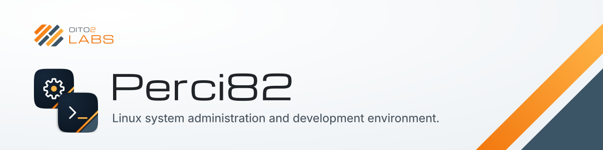
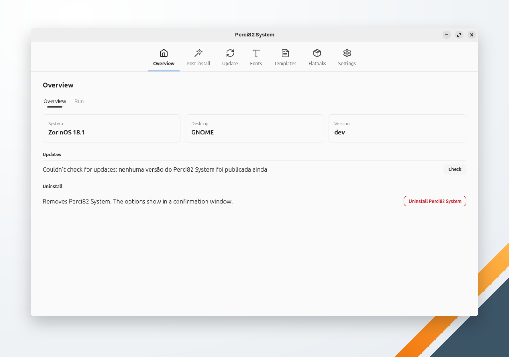

<picture>
  <source media="(prefers-color-scheme: dark)" srcset="../../.github/header-escuro.svg">
  
</picture>

# Perci82

Dois aplicativos desktop para Linux: o **Perci82 System** administra o sistema operacional e o **Perci82 Dev** prepara o seu ambiente de desenvolvimento.

   [](https://github.com/oito2/perci82/actions/workflows/ci.yml)

🌐 **Idioma:** [English](../../README.md) · Português

> **Situação:** o Perci82 System já tem releases (tags `system-vX.Y.Z`). O Perci82 Dev está em desenvolvimento e só pode ser compilado a partir do código-fonte.

## Sumário

- [Visão geral](#visão-geral)
- [Pré-requisitos e instalação rápida](#pré-requisitos-e-instalação-rápida)
- [Instalação automatizada](#instalação-automatizada)
- [Atualização e manutenção](#atualização-e-manutenção)
- [Documentação](#documentação)
- [Licença](#licença)

## Visão geral

O Perci82 é um monorepo com dois aplicativos desktop independentes, feitos em Go com o [Wails v3](https://v3.wails.io). Os dois leem e gravam a mesma pasta `~/.perci`, e cada um é publicado, atualizado e desinstalado separadamente.

| Aplicativo | Binário | O que faz |
|---|---|---|
| **Perci82 System** | `perci82-system` | Administração do Linux: pós-instalação, atualização do sistema e dos aplicativos (pacotes, Snap, Flatpak), fontes, templates de arquivos e aplicativos Flatpak |
| **Perci82 Dev** | `perci82-dev` | Ambiente de desenvolvimento: pré-requisitos, linguagens e SDKs, aplicativos de IA, terminais, IDEs, contêineres Docker, repositórios e contas Git, contextos de IA, skills e servidores MCP; bandeja do sistema opcional |

Principais recursos do Perci82 System:

- **Pós-instalação** — a configuração recomendada do Ubuntu, Ubuntu Budgie, Linux Mint, Zorin OS, Fedora e Pop!_OS, item por item.
- **Atualizar SO & Apps** — pacotes da distribuição, Snap e Flatpak atualizados de uma vez, pedindo a senha uma só vez.
- **Fontes, templates de arquivos e Flatpaks** — listas que instalam o que você marca e removem o que você desmarca.
- **Autoatualização e desinstalação** pela Visão Geral; interface em português e inglês; temas do oito2.



## Pré-requisitos e instalação rápida

| SO | Situação | Distribuições | Dependências de execução |
|---|---|---|---|
| Linux (amd64) | Suportado | Distribuições com `apt` (Debian, Ubuntu, Linux Mint, Zorin OS, Pop!_OS) ou `dnf` (Fedora) | `apt`: `libgtk-4-1 libwebkitgtk-6.0-4` · `dnf`: `gtk4 webkitgtk6.0` |
| Windows | Não suportado | — | — |
| macOS | Não suportado | — | — |

Os binários das releases rodam em Linux amd64 com as bibliotecas de execução do GTK 4 e do WebKitGTK 6.0, que normalmente já estão presentes num Linux desktop. Para instalar uma release, veja a [Instalação automatizada](#instalação-automatizada); a instalação manual está em [Instalar o Perci82 System](system/installation.md#instalação-manual).

### Compilar a partir do código

Requisitos:

- Linux em amd64.
- Go 1.27.4 ou mais recente.
- Pacotes de desenvolvimento do GTK 4 e do WebKitGTK 6.0, por exemplo no Debian/Ubuntu:

  ```bash
  sudo apt install -y build-essential pkg-config libgtk-4-dev libwebkitgtk-6.0-dev
  ```

- Node.js, só para rodar os testes do frontend.

Compilar e executar:

```bash
git clone https://github.com/oito2/perci82.git
cd perci82
make build          # gera ./perci82-system e ./perci82-dev
./perci82-system
./perci82-dev
```

Rodar as verificações:

```bash
make lint
make test
make test-frontend
make check-generated
```

As cores, medidas, presets e textos comuns da interface (OK, Cancelar, Voltar…) vêm do [oito2_ui](https://github.com/oito2/oito2_ui), copiados como fixtures em `internal/theme/parity/`. Para atualizá-los, clone o oito2_ui em `references/oito2_ui` (ou passe `OITO2_UI=<pasta>`) e rode:

```bash
make parity-sync
make generate
```

## Instalação automatizada

Cada aplicativo tem o seu próprio instalador, que instala a release mais recente dele. Perci82 System:

```bash
curl --proto '=https' --proto-redir '=https' --tlsv1.2 --connect-timeout 10 --max-time 600 -fsSL https://raw.githubusercontent.com/oito2/perci82/main/install-system.sh | bash
```

Os instaladores precisam de `curl`, `jq`, `sha256sum`, `tar` e `sudo`. Eles conferem o SHA-256 do binário (e a attestation de build, quando o GitHub CLI está logado), instalam em `/usr/local/bin/perci82-system` ou `/usr/local/bin/perci82-dev` e criam a entrada no menu de aplicativos. Quando o Perci antigo (`prci`) está instalado, perguntam se devem removê-lo; as configurações em `~/.perci` são mantidas, porque os dois aplicativos as usam. O instalador do Perci82 Dev, `install-dev.sh`, funciona do mesmo jeito a partir da primeira release do Perci82 Dev.

## Atualização e manutenção

- **Atualizar:** Visão Geral → **Verificar** procura uma release mais nova do aplicativo; **Atualizar** baixa a release, confere o SHA-256 e substitui o binário. Rodar o instalador de novo também instala a release mais recente. Compilações a partir do código informam a versão `dev` e não se atualizam sozinhas.
- **Desinstalar:** Visão Geral → **Desinstalar** remove o binário, a entrada no menu e os ícones do aplicativo. "Também remover as configurações" remove só as configurações daquele aplicativo (e, no Perci82 Dev, os arquivos da stack Docker e das contas Git em `~/.perci`); a pasta `~/.perci` só é apagada quando nenhum outro aplicativo Perci82 nem o Perci antigo está instalado e não sobrou mais nada nela. Veja [Desinstalar o Perci82 System](system/uninstallation.md).

## Documentação

- [Índice da documentação](index.md)
- [Instalar o Perci82 System](system/installation.md) e [desinstalá-lo](system/uninstallation.md)
- Telas do Perci82 System: [Visão Geral](system/overview.md), [Pós-instalação](system/post-install.md), [Atualizar SO & Apps](system/update.md), [Fontes](system/fonts.md), [Templates](system/templates.md), [Flatpaks](system/flatpaks.md), [Configurações](system/settings.md)
- [Solução de problemas](system/troubleshooting.md)

## Licença

GPL-3.0 — veja [LICENSE](../../LICENSE).
