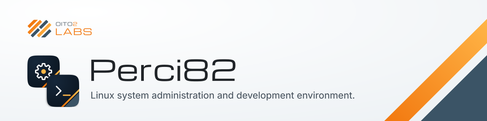
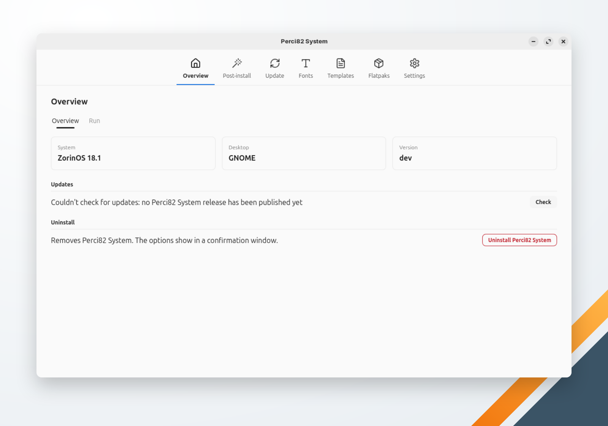

<picture>
  <source media="(prefers-color-scheme: dark)" srcset="../../.github/header-escuro.svg">
  
</picture>

# Perci82

Dois aplicativos desktop para Linux: o **Perci82 System** administra o sistema operacional e o **Perci82 Dev** prepara o seu ambiente de desenvolvimento.

   [](https://github.com/oito2/perci82/actions/workflows/ci.yml)

🌐 **Idioma:** [English](../../README.md) · Português

> **Situação:** o Perci82 System e o Perci82 Dev já têm releases (tags `system-vX.Y.Z` e `dev-vX.Y.Z`).

## Sumário

- [Visão geral](#visão-geral)
- [Pré-requisitos e instalação rápida](#pré-requisitos-e-instalação-rápida)
- [Instalação automatizada](#instalação-automatizada)
- [Atualização e manutenção](#atualização-e-manutenção)
- [Documentação](#documentação)
- [Licença](#licença)

## Visão geral

O Perci82 é um monorepo com dois aplicativos desktop independentes, feitos em Go com o [Wails v3](https://v3.wails.io). Os dois leem e gravam a mesma pasta `~/.perci`, e cada um é publicado, atualizado e desinstalado separadamente.

| Aplicativo | Binário | O que faz |
|---|---|---|
| **Perci82 System** | `perci82-system` | Administração do Linux: pós-instalação, atualização do sistema e dos aplicativos (pacotes, Snap, Flatpak), fontes, templates de arquivos e aplicativos Flatpak |
| **Perci82 Dev** | `perci82-dev` | Ambiente de desenvolvimento: pré-requisitos, linguagens e SDKs, aplicativos de IA, terminais, IDEs, contêineres Docker, repositórios e contas Git, contextos de IA, skills e servidores MCP; bandeja do sistema opcional |

Principais recursos do Perci82 System:

- **Pós-instalação** — a configuração recomendada do Ubuntu, Ubuntu Budgie, Linux Mint, Zorin OS, Fedora e Pop!_OS, item por item.
- **Atualizar SO & Apps** — pacotes da distribuição, Snap e Flatpak atualizados de uma vez, pedindo a senha uma só vez.
- **Fontes, templates de arquivos e Flatpaks** — listas que instalam o que você marca e removem o que você desmarca.
- **Aviso de atualização e desinstalação** na Visão Geral, com o comando do `apt`/`dnf` para copiar; interface em português e inglês; temas do oito2.

Principais recursos do Perci82 Dev:

- **Ambiente** — pré-requisitos, linguagens e SDKs, aplicativos de IA, terminais, IDEs, Android Studio e Antigravity IDE, instalados, atualizados e removidos item por item.
- **Docker** — um stack com Nginx e MariaDB com HTTPS em `https://<app>.localhost`, contêineres de apps Moodle, PHP, Node e PHP + Node, cada um com o seu comando em `~/.local/bin`, pastas de desenvolvimento montadas nos apps e um site de testes do Behat por app Moodle, com um Selenium compartilhado opcional para os cenários `@javascript`.
- **Repositórios** — contas Git com chave SSH, identidade e token de API próprios; os repositórios de cada conta, com clonar, atualizar (pull) e exportar/importar.
- **Contextos de IA** — regras para Claude Code, Gemini, Codex, OpenCode e Antigravity em cada projeto, a partir dos padrões do Perci82 e dos seus contextos personalizados, com anotações de projeto guardadas fora do repositório.
- **Skills & MCPs** — skills do skills.sh e servidores MCP, incluindo o Build82 e o Sync82, registrados nos agentes de programação.
- **Bandeja do sistema** com uma janela compacta de Contêineres; aviso de atualização e desinstalação na Visão Geral; interface em português e inglês; temas do oito2.



## Pré-requisitos e instalação rápida

| SO | Situação | Distribuições | Dependências de execução |
|---|---|---|---|
| Linux (amd64) | Suportado | Debian 13+, Ubuntu 24.04+, Linux Mint 22+, LMDE 7+, Zorin OS 18+, Pop!_OS 24.04+ (`apt`) ou Fedora 40+ (`dnf`) | `apt`: `libgtk-4-1 libwebkitgtk-6.0-4` · `dnf`: `gtk4 webkitgtk6.0` |
| Windows | Não suportado | — | — |
| macOS | Não suportado | — | — |

As releases são pacotes `.deb` e `.rpm` para Linux amd64, publicados num repositório `apt`/`dnf` assinado; o gerenciador de pacotes instala as bibliotecas de execução do GTK 4 e do WebKitGTK 6.0 de que eles dependem. Para instalar, veja a [Instalação automatizada](#instalação-automatizada); adicionar o repositório à mão e instalar um pacote baixado estão em [Instalar o Perci82 System](system/installation.md#adicionar-o-repositório-à-mão) e em [Instalar o Perci82 Dev](dev/installation.md#adicionar-o-repositório-à-mão).

### Compilar a partir do código

Requisitos:

- Linux em amd64.
- Go 1.27.4 ou mais recente.
- Pacotes de desenvolvimento do GTK 4 e do WebKitGTK 6.0, por exemplo no Debian/Ubuntu:

  ```bash
  sudo apt install -y build-essential pkg-config libgtk-4-dev libwebkitgtk-6.0-dev
  ```

- Node.js, só para rodar os testes do frontend.

Compilar e executar:

```bash
git clone https://github.com/oito2/perci82.git
cd perci82
make build          # gera ./perci82-system e ./perci82-dev
./perci82-system
./perci82-dev
```

Rodar as verificações:

```bash
make lint
make test
make test-frontend
make check-generated
make check-bindings   # precisa do CLI wails3 da versão do Wails no go.mod
```

As cores, medidas, presets e textos comuns da interface (OK, Cancelar, Voltar…) vêm do [oito2_ui](https://github.com/oito2/oito2_ui), copiados como fixtures em `internal/theme/parity/`. Para atualizá-los, clone o oito2_ui em `references/oito2_ui` (ou passe `OITO2_UI=<pasta>`) e rode:

```bash
make parity-sync
make generate
```

## Instalação automatizada

Um só script instala um dos aplicativos ou os dois. Ele pergunta quais:

```bash
curl --proto '=https' --tlsv1.2 -fsSL https://raw.githubusercontent.com/oito2/perci82/main/install.sh | bash
```

Ou informe quais — `system`, `dev` ou `all`:

```bash
curl --proto '=https' --tlsv1.2 -fsSL https://raw.githubusercontent.com/oito2/perci82/main/install.sh | bash -s -- system dev
```

O script precisa de `curl`, `gpg` e `sudo`. Ele baixa a chave do repositório do Perci82 e confere a impressão digital dela (`A1B1 AC75 B535 0344 B6C8  043C FF9E 1B0F 3C2A 545F`), adiciona o repositório de pacotes (`https://oito2.github.io/perci82/`) ao `apt` ou ao `dnf` e instala os pacotes `perci82-system` e/ou `perci82-dev`. Quando o Perci antigo (`prci`) está instalado, pergunta se deve removê-lo; as configurações em `~/.perci` são mantidas, porque os dois aplicativos as usam.

## Atualização e manutenção

- **Atualizar:** o gerenciador de pacotes atualiza os dois aplicativos junto com o resto do sistema (`sudo apt update && sudo apt upgrade` ou `sudo dnf upgrade`). Visão Geral → **Verificar** procura uma release mais nova e, quando o aplicativo roda a partir do pacote, mostra o comando que a instala. Compilações a partir do código informam a versão `dev`.
- **Desinstalar:** Visão Geral → **Desinstalar** limpa o que é do aplicativo: "Também remover as configurações" remove só as configurações daquele aplicativo (e, no Perci82 Dev, os arquivos das contas Git em `~/.perci` e, junto com os contêineres Docker, os arquivos da stack Docker, mantendo os backups do MariaDB); a pasta `~/.perci` só é apagada quando nenhum outro aplicativo Perci82 nem o Perci antigo está instalado e não sobrou mais nada nela. A janela de desinstalação do Perci82 Dev também oferece backups do Docker, dos repositórios e dos contextos de IA, e a remoção dos contêineres Docker. No fim, ela mostra o comando que remove o pacote (`sudo apt remove perci82-<app>` ou `sudo dnf remove perci82-<app>`). Veja [Desinstalar o Perci82 System](system/uninstallation.md) e [Desinstalar o Perci82 Dev](dev/uninstallation.md).

## Documentação

- [Índice da documentação](index.md)
- [Instalar o Perci82 System](system/installation.md) e [desinstalá-lo](system/uninstallation.md)
- Telas do Perci82 System: [Visão Geral](system/overview.md), [Pós-instalação](system/post-install.md), [Atualizar SO & Apps](system/update.md), [Fontes](system/fonts.md), [Templates](system/templates.md), [Flatpaks](system/flatpaks.md), [Configurações](system/settings.md)
- [Instalar o Perci82 Dev](dev/installation.md) e [desinstalá-lo](dev/uninstallation.md)
- Telas do Perci82 Dev: [Visão Geral](dev/overview.md), [Ambiente](dev/environment.md), [Docker](dev/docker.md), [Repositórios](dev/repositories.md), [Contextos de IA](dev/ai-contexts.md), [Skills & MCPs](dev/skills-mcps.md), [Configurações](dev/settings.md)
- Solução de problemas: [Perci82 System](system/troubleshooting.md) e [Perci82 Dev](dev/troubleshooting.md)
- [Contribuindo](contribuindo.md) — compilação, verificações, pull requests e releases
- [Código de Conduta](codigo-de-conduta.md)

## Licença

GPL-3.0 — veja [LICENSE](../../LICENSE).
