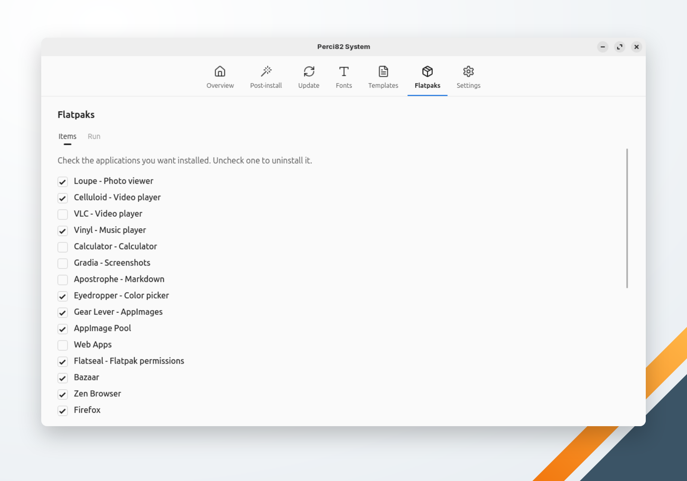

🌐 [English](../../en/system/flatpaks.md) | **Português** | 🏠 [Índice](../index.md)

---

# Flatpaks

Instala e remove aplicativos desktop do [Flathub](https://flathub.org). Cada caixa de seleção mostra se o aplicativo está instalado: marque os que quer, desmarque os que quer remover e clique em **Executar**.

<!-- TODO: capture a screenshot of the Flatpaks screen -->

| Aplicativo | ID do Flatpak |
|---|---|
| Loupe — Visualizador de Fotos | `org.gnome.Loupe` |
| Celluloid — Visualizador de Vídeo | `io.github.celluloid_player.Celluloid` |
| VLC — Visualizador de Vídeo | `org.videolan.VLC` |
| Vinyl — Player de Música | `page.codeberg.M23Snezhok.Vinyl` |
| Calculator — Calculadora | `org.gnome.Calculator` |
| Gradia — Captura de Tela | `be.alexandervanhee.gradia` |
| Apostrophe — Markdown | `org.gnome.gitlab.somas.Apostrophe` |
| Eyedropper — Conta Gotas | `com.github.finefindus.eyedropper` |
| Gear Lever — AppImages | `it.mijorus.gearlever` |
| AppImage Pool | `io.github.prateekmedia.appimagepool` |
| Web Apps | `net.codelogistics.webapps` |
| Flatseal — Gerenciar Flatpak | `com.github.tchx84.Flatseal` |
| Bazaar | `io.github.kolunmi.Bazaar` |
| Zen Browser | `app.zen_browser.zen` |
| Firefox | `org.mozilla.firefox` |
| Chromium | `org.chromium.Chromium` |
| FileZilla | `org.filezillaproject.Filezilla` |
| Inkscape | `org.inkscape.Inkscape` |
| Krita | `org.kde.krita` |
| Penpot | `com.authormore.penpotdesktop` |
| LibreOffice | `org.libreoffice.LibreOffice` |
| OnlyOffice | `org.onlyoffice.desktopeditors` |
| AnyDesk | `com.anydesk.Anydesk` |
| DBeaver Community | `io.dbeaver.DBeaverCommunity` (instalado com acesso à rede liberado) |
| Beekeeper Studio | `io.beekeeperstudio.Studio` |
| Meld — Comparar Arquivos | `org.gnome.meld` |
| Tomatillo — Pomodoro | `io.github.diegopvlk.Tomatillo` |
| Extension Manager (GNOME) | `com.mattjakeman.ExtensionManager` |

Quando faltam o Flatpak ou o repositório Flathub, a execução instala e adiciona os dois antes. Os aplicativos são instalados no escopo escolhido em [Configurações](settings.md): **Sistema (todos os usuários)**, o padrão, pede a sua senha; **Usuário (só você)** não pede. Um aplicativo que falha não interrompe os outros: a execução termina listando os que falharam.
