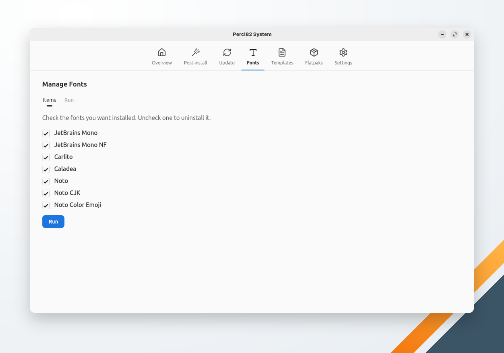

🌐 [English](../../en/system/fonts.md) | **Português** | 🏠 [Índice](../index.md)

---

# Gerenciar Fontes

Instala e remove fontes. Cada caixa de seleção mostra se a fonte está instalada: marque as fontes que quer, desmarque as que quer remover e clique em **Executar**.

<!-- TODO: capture a screenshot of the Manage Fonts screen -->

| Fonte | Origem |
|---|---|
| JetBrains Mono | Baixada da release da JetBrains no GitHub (com SHA-256 conferido) para `~/.local/share/fonts/perci/jetbrains-mono/` |
| JetBrains Mono NF | A versão Nerd Fonts, baixada do GitHub (com SHA-256 conferido) para `~/.local/share/fonts/perci/jetbrains-mono-nf/` |
| Carlito | Pacote `fonts-crosextra-carlito` (`apt`) ou `google-carlito-fonts` (`dnf`) |
| Caladea | Pacote `fonts-crosextra-caladea` (`apt`) ou `google-crosextra-caladea-fonts` (`dnf`) |
| Noto | Pacote `fonts-noto` (`apt`) ou `google-noto-sans-fonts` (`dnf`) |
| Noto CJK | Pacote `fonts-noto-cjk` (`apt`) ou `google-noto-sans-cjk-fonts` (`dnf`) |
| Noto Color Emoji | Pacote `fonts-noto-color-emoji` (`apt`) ou `google-noto-color-emoji-fonts` (`dnf`) |

As fontes de pacote pedem a sua senha; as baixadas vão para a sua pasta pessoal e não pedem. O cache de fontes é atualizado no fim. Uma fonte que falha não interrompe as outras: a execução termina listando as que falharam.
