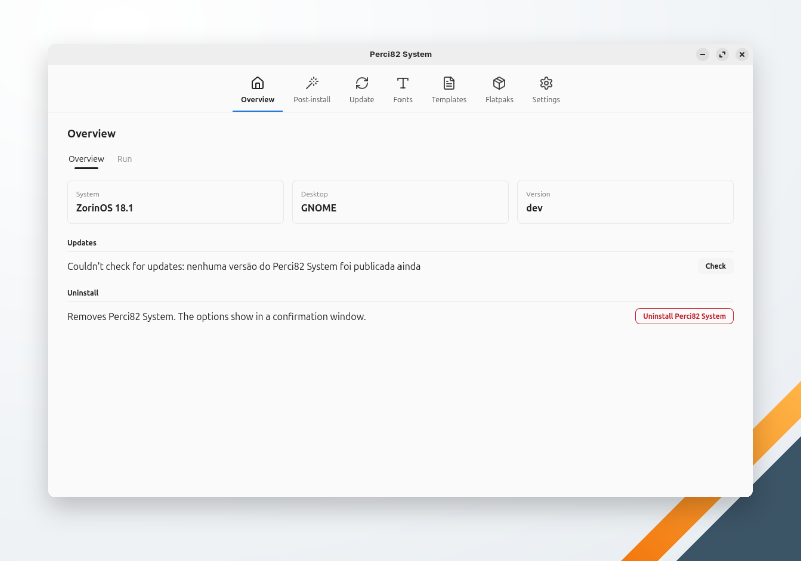

🌐 [English](../../en/system/overview.md) | **Português** | 🏠 [Índice](../index.md)

---

# Visão Geral

A primeira tela do Perci82 System: o que ele detectou, a versão, as atualizações e a desinstalação.

<!-- TODO: capture a screenshot of Perci82 System's Overview -->

## A janela

As seções do Perci82 System são abas no alto da janela: **Visão Geral**, **Pós-instalação**, **Atualizar**, **Fontes**, **Templates**, **Flatpaks** e **Configurações**. As telas que executam ações têm duas abas internas:

- **Itens** — o que aplicar, instalar ou remover, e o botão que inicia a ação.
- **Execução** — a ação em andamento: a barra de progresso e a saída dos comandos.

Só uma ação roda por vez, e a janela não fecha enquanto uma está rodando. Ações que precisam de permissão de administrador nunca rodam no Perci82 System e no Perci82 Dev ao mesmo tempo: enquanto um aplicativo executa uma delas, o outro recusa com uma mensagem que diz qual aplicativo está ocupado.

## Cards

| Card | Mostra |
|---|---|
| **Sistema** | O perfil de [pós-instalação](post-install.md) da máquina (ex.: "ZorinOS 18.1 Lite"); num sistema sem perfil, o nome e a versão da distribuição |
| **Ambiente** | O ambiente gráfico (GNOME, KDE Plasma, Cinnamon, XFCE, Budgie, COSMIC…) |
| **Versão** | A versão do Perci82 System, com o selo **em dia** ou **nova versão** depois de cada verificação |

## Atualização

O aplicativo procura uma versão mais nova quando a tela abre (de novo, no máximo a cada 10 minutos); **Verificar** procura na hora. Ele olha só as versões do próprio Perci82 System (tags `system-vX.Y.Z`) no GitHub.

Quando existe uma versão mais nova, aparece **Atualizar**. Ele baixa o novo binário, confere o SHA-256 pelo `checksums.txt` da release, substitui o binário instalado e mostra o andamento na aba **Execução**. Depois, reinicie o aplicativo.

Uma compilação a partir do código-fonte informa a versão `dev` e não se atualiza sozinha.

## Desinstalar

**Desinstalar Perci82 System** abre uma janela de confirmação. Ela remove o binário, a entrada no menu de aplicativos e os ícones; **Também remover as configurações do Perci82 System** (desmarcada sempre que a janela abre) remove também as configurações. Veja [Desinstalar](uninstallation.md).
