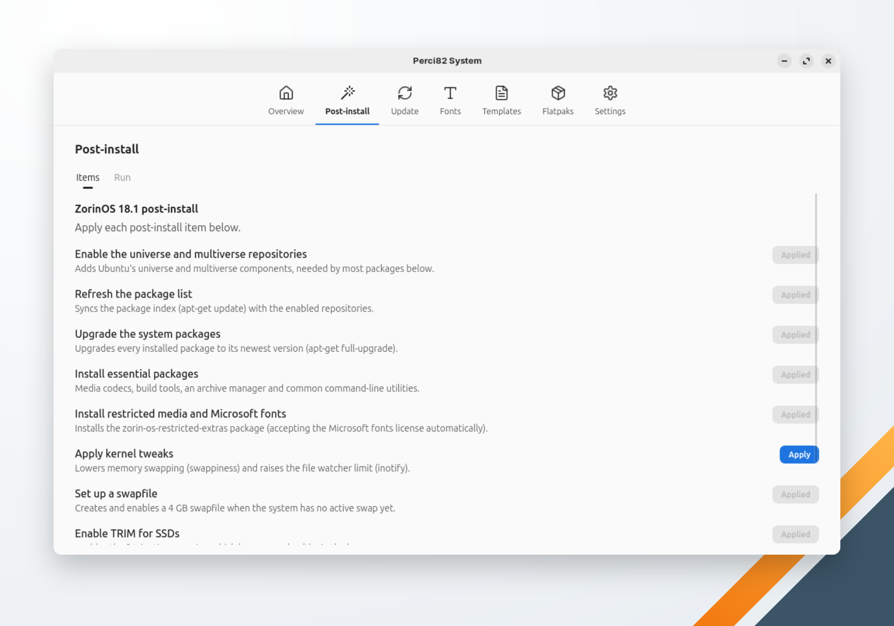

🌐 [English](../../en/system/post-install.md) | **Português** | 🏠 [Índice](../index.md)

---

# Pós-instalação

Configuração recomendada para um sistema recém-instalado, item por item. Cada item tem o seu próprio botão **Aplicar**.

## Sistemas suportados

A tela mostra os itens do perfil que corresponde à máquina (`/etc/os-release` e o ambiente gráfico). Em qualquer outro sistema, ela avisa que o sistema não é suportado; as outras telas continuam funcionando.

| Perfil | Corresponde a |
|---|---|
| Ubuntu 24.04 / Ubuntu 26.04 | Ubuntu 24.04 ou 26.04 com qualquer ambiente gráfico, menos Budgie |
| Ubuntu Budgie 24.04 / Ubuntu Budgie 26.04 | Ubuntu 24.04 ou 26.04 com Budgie |
| Linux Mint Cinnamon / Linux Mint XFCE | Linux Mint com Cinnamon ou XFCE (qualquer versão) |
| ZorinOS 18.1 / ZorinOS 18.1 Lite | Zorin OS com GNOME (Core) ou XFCE (Lite) (qualquer versão) |
| Fedora 44 / Fedora 44 Budgie | Fedora com qualquer ambiente gráfico, ou com Budgie (qualquer versão) |
| Pop!_OS 24.04 COSMIC | Pop!_OS 24.04 com COSMIC |

## Itens

Os itens aparecem em ordem. Alguns exigem outro antes: eles mostram **Requer: …** e o botão fica desligado até aquele item ser aplicado. Itens já aplicados mostram **Aplicado**.

| Item | O que faz | Perfis |
|---|---|---|
| Habilitar repositórios universe e multiverse | Adiciona os componentes universe e multiverse do Ubuntu | Ubuntu, Ubuntu Budgie, Mint, Zorin |
| Atualizar lista de pacotes | `apt-get update` | Ubuntu, Ubuntu Budgie, Mint, Zorin |
| Atualizar pacotes do sistema | `apt-get full-upgrade` | Ubuntu, Ubuntu Budgie, Mint, Zorin, Pop!_OS |
| Aplicar backports-budgie | Adiciona o PPA backports-budgie e aplica as atualizações dele; faça antes um snapshot do Timeshift | Ubuntu Budgie 26.04 |
| Instalar pacotes essenciais (e codecs) | Ferramentas de compilação e utilitários de linha de comando comuns (o conjunto depende do perfil, ex.: Timeshift no Ubuntu, no Mint e no Pop!_OS); no Ubuntu e no Ubuntu Budgie, também os codecs restritos, aceitando a licença das fontes Microsoft | Todos |
| Instalar fontes Microsoft | `ttf-mscorefonts-installer`, aceitando a licença | Mint |
| Instalar mídias restritas e fontes Microsoft | `zorin-os-restricted-extras`, aceitando a licença das fontes Microsoft | Zorin |
| Instalar codecs multimídia | Os extras restritos do Ubuntu e plugins do GStreamer no Pop!_OS; o `ffmpeg` completo e o grupo multimedia no Fedora | Pop!_OS, Fedora |
| Atualizar sistema base | `dnf upgrade --refresh` | Fedora |
| Habilitar RPM Fusion | Adiciona os repositórios RPM Fusion free e nonfree | Fedora |
| Instalar unrar | Do RPM Fusion nonfree | Fedora |
| Instalar suporte a NTFS | `ntfs-3g` | Fedora |
| Aplicar ajustes de kernel | Reduz o swappiness e aumenta o limite de observadores do inotify (`/etc/sysctl.d/99-perci.conf`) | Todos |
| Configurar swapfile | Cria e ativa um `/swapfile` de 4 GB quando não há swap ativo | Ubuntu, Ubuntu Budgie, Mint, Zorin |
| Ativar TRIM para SSDs | Ativa o `fstrim.timer` | Todos |
| Driver de vídeo Intel (VA-API) / Driver de vídeo AMD (VA-API) | Aceleração de vídeo por hardware — aplique só o da sua placa de vídeo | Todos |
| Configurar Flatpak / Instalar Flatpaks essenciais | Instala o Flatpak, adiciona o Flathub e instala o VLC e um gerenciador de web apps (só o gerenciador de web apps no Ubuntu Budgie 26.04) | Ubuntu, Ubuntu Budgie, Mint, Pop!_OS |
| Detectar drivers adicionais | `ubuntu-drivers autoinstall` (ex.: NVIDIA) | Ubuntu, Ubuntu Budgie, Mint |
| Limpar pacotes desnecessários | `dnf autoremove` e `dnf clean all` | Fedora |

Os itens de Flatpak usam o escopo escolhido em [Configurações](settings.md).

## Como "Aplicado" é decidido

Itens cujo resultado dá para ver no sistema (um pacote, um repositório, uma configuração) são conferidos ali. Itens que não deixam nada para conferir (como atualizar a lista de pacotes) contam como aplicados depois de rodarem com sucesso; esse registro fica no `~/.perci/config.yaml`, junto com o `/etc/machine-id` da máquina, para que registros de um sistema reinstalado não contem.

A pós-instalação não tem como desfazer: para reverter um item, use as ferramentas da sua distribuição.
