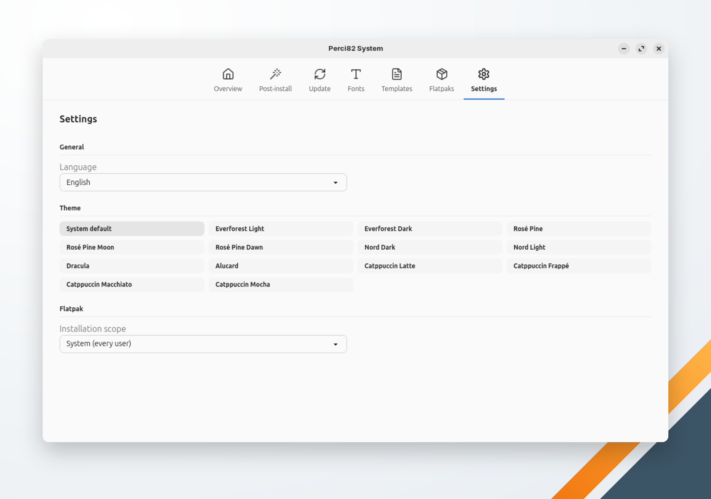

🌐 [English](../../en/system/settings.md) | **Português** | 🏠 [Índice](../index.md)

---

# Configurações

As preferências do próprio Perci82 System. Toda mudança é salva e aplicada na hora; não há botão Salvar.

<!-- TODO: capture a screenshot of the Settings screen -->

## Geral

**Idioma** escolhe o idioma do aplicativo inteiro, inclusive das mensagens de progresso das ações:

- **Definido pelo sistema** — português quando o idioma do sistema (`LC_ALL`, `LC_MESSAGES` ou `LANG`) é português; inglês nos demais casos.
- **Português (Brasil)**.
- **English**.

A troca vale na hora, sem reiniciar. Detalhes técnicos de erros aparecem em inglês. O Perci82 Dev tem a sua própria configuração de idioma.

## Tema

- **Definido pelo sistema** segue a preferência de claro ou escuro, a cor de destaque e o alto contraste do ambiente gráfico, e muda junto com eles enquanto o aplicativo está aberto.
- Os 13 presets do oito2: Everforest Light, Everforest Dark, Rosé Pine, Rosé Pine Moon, Rosé Pine Dawn, Nord Dark, Nord Light, Dracula, Alucard, Catppuccin Latte, Catppuccin Frappé, Catppuccin Macchiato e Catppuccin Mocha.

O Perci82 System guarda o tema separado do tema do Perci82 Dev.

## Flatpak

**Escopo de instalação** é onde os [Flatpaks](flatpaks.md) e os itens de Flatpak da [Pós-instalação](post-install.md) instalam os aplicativos:

- **Sistema (todos os usuários)** — o padrão; pede a sua senha.
- **Usuário (só você)** — instala na sua pasta pessoal, sem senha.

## Onde as configurações ficam salvas

No `~/.perci/config.yaml`, compartilhado com o Perci82 Dev. Cada aplicativo grava só as próprias chaves e mantém as outras como estão.

| Chave | Guarda |
|---|---|
| `system_language` | O idioma: `system`, `pt-BR` ou `en` |
| `system_gui_theme` | O tema |
| `flatpak_scope` | `system` ou `user` |
| `postinstall_applied` | Os itens da pós-instalação que rodaram com sucesso, por perfil |
| `postinstall_machine_id` | O `/etc/machine-id` a que esses registros pertencem |
