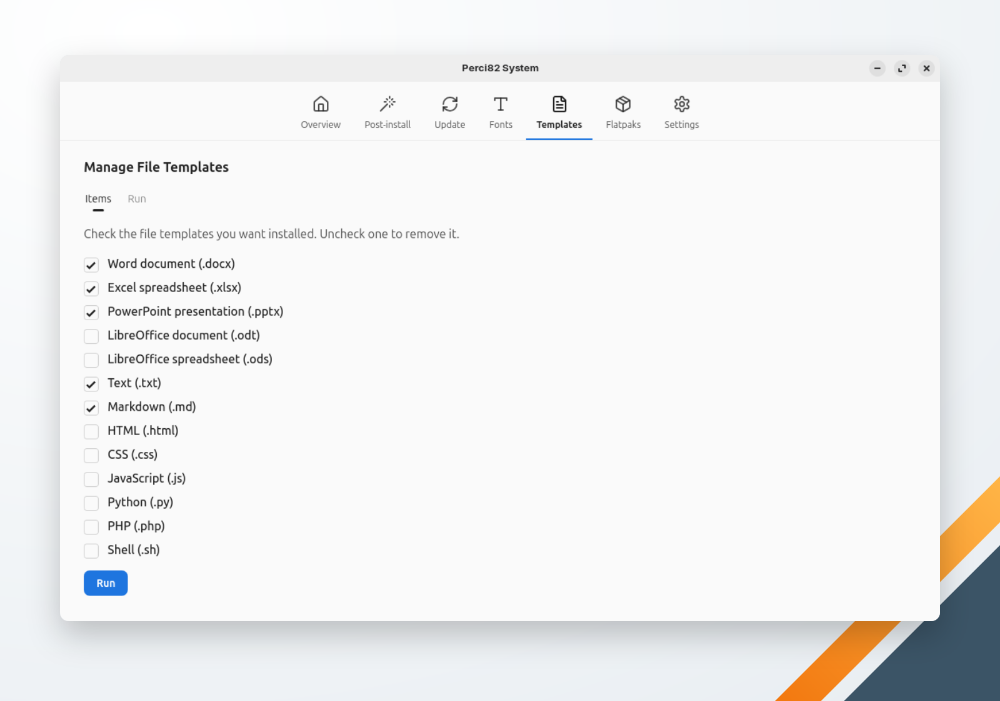

🌐 [English](../../en/system/templates.md) | **Português** | 🏠 [Índice](../index.md)

---

# Gerenciar Templates de Arquivos

Coloca templates de arquivos vazios na sua pasta de modelos, para o menu **Novo Documento** do gerenciador de arquivos poder criá-los. Marque os templates que quer, desmarque os que quer remover e clique em **Executar**.

| Template | Arquivo |
|---|---|
| Documento Word (.docx) | `Documento.docx` |
| Planilha Excel (.xlsx) | `Planilha.xlsx` |
| Apresentação PowerPoint (.pptx) | `Apresentacao.pptx` |
| Documento LibreOffice (.odt) | `Documento.odt` |
| Planilha LibreOffice (.ods) | `Planilha.ods` |
| Texto (.txt) | `Texto.txt` |
| Markdown (.md) | `Documento.md` |
| HTML (.html) | `HTML.html` |
| CSS (.css) | `Estilo.css` |
| JavaScript (.js) | `Script.js` |
| Python (.py) | `Script.py` |
| PHP (.php) | `PHP.php` |
| Shell (.sh) | `Shell.sh` |

A pasta de modelos é a que o `xdg-user-dir TEMPLATES` informa; sem ela, `~/Modelos` quando essa pasta existe, senão `~/Templates`. Um arquivo que já existe é mantido como está. Não é pedida senha.
