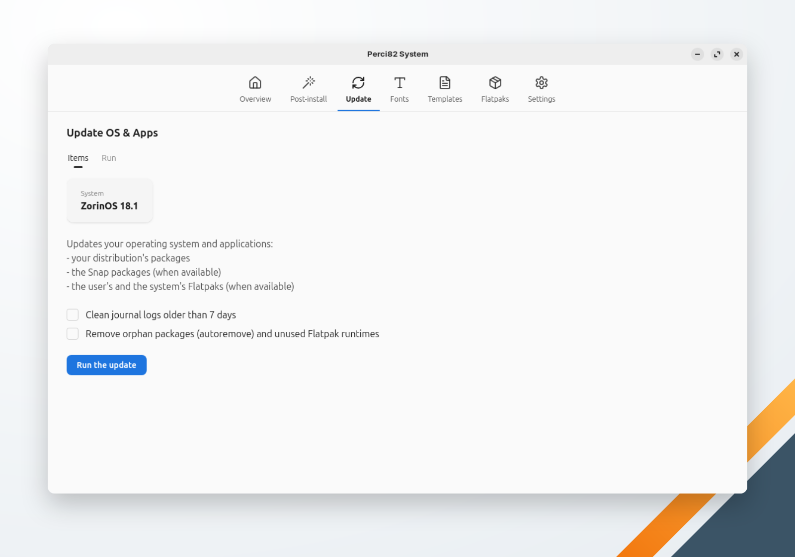

🌐 [English](../../en/system/update.md) | **Português** | 🏠 [Índice](../index.md)

---

# Atualizar SO & Apps

Atualiza o sistema operacional e os aplicativos de uma vez, pedindo a senha uma só vez.

<!-- TODO: capture a screenshot of the Update OS & Apps screen -->

## Etapas

**Executar atualização** roda, em ordem, as etapas que se aplicam à máquina:

| Etapa | Sistemas com `apt` | Sistemas com `dnf` |
|---|---|---|
| Pacotes | `apt-get update`, `apt-get full-upgrade`, `apt-get autoclean` | `dnf upgrade --refresh` |
| Pacotes Snap (quando o `snap` está instalado) | `snap refresh` | `snap refresh` |
| Flatpaks do sistema (quando o Flatpak está instalado) | `flatpak update --system` | `flatpak update --system` |
| Flatpaks do usuário (quando o Flatpak está instalado) | `flatpak update --user` | `flatpak update --user` |

Todas as etapas com privilégio rodam num só lote, então a senha é pedida uma vez. Uma etapa que falha não interrompe as outras: a execução termina com um aviso dizendo o que falhou.

## Opções

As duas vêm desmarcadas:

- **Limpar logs do journal com mais de 7 dias** — `journalctl --vacuum-time=7d`.
- **Remover pacotes órfãos (autoremove) e runtimes Flatpak sem uso** — `apt-get autoremove` ou `dnf autoremove`, e `flatpak uninstall --unused` do sistema e do usuário.

## Sistemas não suportados

Num sistema sem `apt` e sem `dnf`, a atualização para com "Distribuição não suportada. Gerenciador de pacotes não reconhecido."
